> **Education and research only.** This is a personal simulation project. The base robot model (Lite6) originates from the publicly available [MuJoCo Menagerie](https://github.com/google-deepmind/mujoco_menagerie).
>
> Except for parameters supplied with that robot model in the official MuJoCo Menagerie repository, all parameters used in this project are my own reasonable assumptions for simulation and do not represent data from a real robot. This includes additional model settings, friction parameters, controller gains, planning limits, and supervisory thresholds.
>
> All planning and control algorithms are designed for research and personal study; they do not represent the control algorithms used in actual Lite6 hardware, nor is this project affiliated with, sponsored by, or endorsed by the Lite6 trademark or any commercial entity.

# Six-Axis Robot Trajectory Planning, Dynamic Control, and Compliance Control Based on ROS 2 and MuJoCo

### 基于 ROS 2 与 MuJoCo 的六轴机械臂轨迹规划、动力学控制与柔顺控制


## Overview

This README is quite long; if you would like a quick overview of the project, please watch the [video](demo/demo_main.mp4).

This repository is a personal, end-to-end robotics simulation and control software stack for a six-axis robotic manipulator built on **ROS 2 Jazzy** and **MuJoCo 3.9.0**. The architecture splits cleanly into two specialized high-level applications that share a common real-time simulation backend, inter-process communication protocol, kinematics/collision library, and low-level dynamic controller: a **Debugging Version** tailored for single-move motion verification, interactive encoder-based compliance/drag teaching, payload testing, gripper operation, and automated friction identification; and a **Studio Version** featuring a custom robotic motion **Domain-Specific Language (DSL)**, a five-stage offline trajectory compiler, and a PyQt5 **Trajectory Programming IDE** with real-time execution monitoring, live pausing/resuming, and diagnostic reporting. The six-axis arm motion and compliance controller assumes no joint torque sensors and uses joint encoder measurements and rigid-body models without simulator contact-force feedback. The simulated gripper is separate: its grasp estimator reads MuJoCo contact forces, and its drive uses MuJoCo bias-force feedforward.

At the planning and optimization layer, the project avoids MoveIt 2 and external trajectory-generation libraries in favor of custom C++17 solvers. A shared kinematics and collision library combines a symbolically derived 8-branch closed-form **analytical inverse kinematics** solver ([`FK-and-IK.mw`](FK-and-IK.mw)) with local SVD-DLS numerical correction and forward-kinematics residual verification, weighted branch selection with quadrant-jump filtering, dimensionless length-normalized Jacobian minimum-singular-value checks, and **Coal (formerly HPP-FCL)** collision checking against URDF meshes, SRDF exclusions, and the workbench ground plane. On top of that engine, the Studio compiler supports `MoveJ`, `MoveP`, `MoveL`, `MoveC` (both three-point and center-angle circular arcs), multi-waypoint joint-space and Cartesian-space `MovePVA` (with optional interior-waypoint velocities and accelerations, mandatory terminal rest, and fixed segment durations rounded to the nearest 1 ms), `Gripper`, `Wait`, `SetPayload`, and scoped `ImpedanceCartesian` compliance blocks. Geometric paths use composite C³-continuous Cartesian and joint curves with degree-7 Bernstein/Bézier corner blends and SO(3) Lie-algebra septic splines. Time parameterization is solved by a custom **third-order jerk-limited TOPP** (Time-Optimal Path Parameterization) solver combining a TOPP-RA warm start with a banded Interior Point Method (IPM) and adaptive mesh refinement. For point-to-point and explicit PVA trajectories, I implemented a native multi-DOF **third-order bounded-position online trajectory generator (OTG)** with blocked-interval handling and boundary-contact search, a 7-segment double-S curve generator, a deterministic L-BFGS/coordinate-search **joint-space PVA optimizer**, and an adaptive cubic joint-space **Cartesian PVA direct collocation solver** using analytical Pinocchio kinematic derivatives and a banded SQD IPM. Live pausing during rigid trajectory execution normally uses path-preserving septic time-scaling trajectory splicing, with goal cancellation as a fallback when the splice cannot be confirmed. Remaining path segments are dynamically replanned upon resume or after compliant contact deflection.

Both upper-level stacks are orchestrated by authoritative event-driven **Supervisors** designed using **Discrete Event System (DES) / Supervisory Control Theory (SCT)** principles. Each supervisor draws a strict boundary between *controllable* events: operator commands such as motion dispatch, compliance mode switches, friction identification starts, Run/Pause/Resume/Step/Stop requests, fault resets, and recovery, which are admitted only when explicit state, telemetry-freshness, session, and monotonic `(planner_epoch, revision)` guards are satisfied, and *uncontrollable* observations: low-level controller E-STOP latches, real-time mode transitions, path-tolerance or effort-saturation trips, heartbeat staleness, and action completions, which the supervisor can never suppress or ignore. Neither PyQt5 front-end synthesizes operating state locally; both HMIs merely issue guarded command events and render snapshots published by their supervisor, while `Lite6CTCController` remains the sole authority for low-level real-time modes (never inferred optimistically from outgoing requests, with any ambiguous command outcome reconciled against `/ctc_controller/status` telemetry). In the Debugging stack, `lite6_planner::Supervisor` decouples orthogonal operating modes (`INITIALIZING`, `NORMAL`, `SYSID`, `JOINT_IMPEDANCE`, `CARTESIAN_IMPEDANCE`, `TEACH`, `COMPLIANCE_SWITCHING`, `ESTOP`, `RECOVERING`, `SOFT_FAULT`) from motion execution phases (`IDLE`, `PLANNING`, `WAITING_CTC`, `EXECUTING`, `CANCELING`) and session-scoped identification/recovery sub-phases. In the Studio stack, `lite6_studio_planner::StudioSupervisor` governs the program execution lifecycle (`BOOT_INIT`, `IDLE`, `COMPILED_READY`, `RUNNING`, `PAUSED`, `STEPPING`, `STOPPING`, `ESTOP`, `FAULT`, `RECOVERING`), serializing auto-load compilation against execution dispatch and enforcing multi-stage E-STOP recovery (`WAIT_SETTLE -> ENABLE_NORMAL -> POST_SETTLE`) gated by continuous physical settling (`max |dq| <= 0.015 rad/s` for `300 ms`) and bounded watchdogs, while `CMD_ESTOP` always bypasses epoch and revision guards as an unblocked safety preemption path.

At the real-time control and physics layer, a unified 1 kHz `ros2_control` effort controller (`Lite6CTCController`) owns all low-level mode transitions and real-time safety latches across eight operating states (`NORMAL`, `SYS_ID`, `JOINT_IMPEDANCE`, `CARTESIAN_IMPEDANCE`, `TEACH`, `CARTESIAN_IMPEDANCE_TRAJECTORY`, `COMPLIANCE_STOPPING`, and `ESTOP`), guarded by a lock-free command gateway with activation-epoch checks and an unblocked `CMD_ESTOP` preemption fast-path. In `NORMAL` mode, **Computed Torque Control (CTC)** combines **Pinocchio RNEA** inverse dynamics (including an online exponentially smoothed payload inertia model on `joint6` with bumpless gravity-to-integrator handover), **rotor inertia (armature) compensation**, reference-velocity viscous and smoothed Coulomb **friction compensation**, and a **torque-domain integrator** with back-calculation anti-windup and transition slew limiting. Compliance control runs strictly on joint encoders and rigid-body dynamics: joint-space impedance, world-aligned Cartesian impedance (with SO(3) `Jlog3` rotational springs, operational-space effective-inertia damping-ratio scaling, and Woodbury-form passive M-weighted nullspace singularity damping), `diag(M)`-normalized gravity-compensated **drag teaching**, and time-varying 1 kHz **Cartesian impedance trajectory tracking** with powered inertial/Coriolis/gravity feedforward, velocity-aligned friction feedforward, and `LOCAL_WORLD_ALIGNED` feedforward wrenches. The MuJoCo hardware backend runs physics in a dedicated 10 kHz (`0.1 ms` fixed step) thread requesting `SCHED_FIFO` scheduling, injecting per-joint **LuGre dynamic bristle friction** (Stribeck curve plus exact constant-velocity exponential bristle updates via `expm1`) alongside an independent force-limited simulated wide gripper with contact-estimated `GRASPED` feedback that remains decoupled from arm E-STOP. High-rate joint state, viewer state, controller reference (**shadow robot**), interactive **MuJoCo mouse spring force/torque perturbations**, and buffered **Fourier friction identification** telemetry (`SYS_ID` generalized momentum-integral estimation) traverse lock-free **POSIX shared memory** (`ShmSeqRegister` SeqLocks and `ShmSpscRing`) between processes without waiting for the native GLFW/OpenGL viewer or PyQt5 GUIs. The bounded SysID SPSC ring drops incoming samples and increments a drop counter when full; timely consumer draining is required to avoid data loss.

### Open-Source Foundations vs. Custom Implementation

To be completely transparent about the engineering boundaries of this repository, here is what relies on open-source software and what I implemented myself:

* **Built on open-source resources:**
  * **MuJoCo 3.9.0 & MuJoCo Menagerie:** Rigid-body and contact physics engine, `mjv`/`mjr` OpenGL rendering primitives, and the base six-axis manipulator meshes and baseline inertial parameters.
  * **ROS 2 Jazzy & `ros2_control`:** Middleware communication (topics, services, actions), `controller_manager`, hardware/controller plugin interfaces, and `realtime_tools`.
  * **Pinocchio:** Multibody kinematics and dynamics algorithms (RNEA, CRBA mass matrix, Coriolis matrix, generalized gravity, forward kinematics, frame Jacobians, `log3`/`Jlog3`, and analytical kinematic derivatives).
  * **Coal (formerly HPP-FCL):** Mesh and primitive geometric collision detection paired with Pinocchio's geometry model.
  * **Eigen, GLFW, PyQt5, NumPy, SciPy, yaml-cpp / PyYAML:** Dense linear algebra and matrix factorizations, OpenGL windowing and input handling, desktop GUI frameworks, bounded least-squares estimation (`scipy.optimize.lsq_linear`) for offline friction fitting, and YAML configuration parsing.
* **Implemented from scratch by me:**
  * **Kinematics & validation (`lite6_kinematics`):** Symbolically derived closed-form 8-branch analytical IK with local SVD-DLS correction and FK residual verification, branch continuity and quadrant-jump filtering, length-normalized Jacobian singularity checks, and Coal collision wrapper.
  * **DSL, compiler & trajectory solvers (`lite6_studio_planner`, also backing `lite6_planner`):** Custom motion DSL lexer/parser/AST and five-stage compiler; C³ degree-7 Bernstein/Bézier corner blending in both Cartesian and joint space plus SO(3) septic splines; 3rd-order jerk-limited TOPP solver (TOPP-RA warm start + banded IPM + adaptive refinement); native multi-DOF 3rd-order bounded-position OTG and 7-segment double-S curve solvers; multi-waypoint joint-space PVA optimizer; adaptive cubic Cartesian PVA direct collocation solver; septic time-scaling pause splicing; and dynamic post-pause/post-contact block replanning.
  * **Dynamics, compliance & safety controller (`lite6_controllers`):** The entire 1 kHz `Lite6CTCController` covering CTC `NORMAL` mode, real-time smoothed payload updates, frictionless `SYS_ID` mode, joint/Cartesian impedance, `diag(M)`-normalized drag teaching, time-varying Cartesian impedance trajectory tracking, bumpless handovers, kinematic E-STOP deceleration tracking, and the lock-free epoch-guarded command gateway.
  * **Simulation backend, IPC & native viewer (`lite6_hardware`, `lite6_interfaces`):** 10 kHz dedicated MuJoCo physics thread with lock-free SPSC/triple-buffer exchange, per-joint LuGre bristle friction, independent force-limited wide-gripper controller and contact grasp estimator, POSIX shared-memory SeqLock/SPSC IPC bridge (C++ and Python), and standalone native GLFW/OpenGL viewer with shadow robot overlay and mouse spring perturbation feedback.
  * **Supervisors, identification & front-ends (`lite6_planner`, `lite6_studio_planner`, `lite6_hmi`, `lite6_studio_hmi`):** Both Discrete Event System (DES/SCT) Supervisors (Debugging and Studio), automated Fourier generalized-momentum friction identification, and both PyQt5 interfaces (Debugging HMI and Trajectory Programming IDE).

<p align="center">
  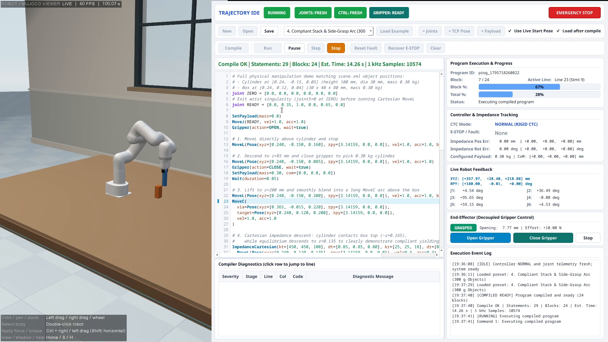
</p>

## Table of Contents

1. [Overview](#overview)
2. [System Architecture](#system-architecture)
3. [CTC Controller Architecture (NORMAL Mode)](#ctc-controller-architecture-normal-mode)
4. [Robot Trajectory Programming Language (DSL) Syntax](#robot-trajectory-programming-language-dsl-syntax)
5. [Demonstrations](#demonstrations)
   * [Studio Demonstration Trajectories](#1-studio-demonstration-trajectories)
   * [Debugging Version: Encoder-Based Compliance and Drag Teaching](#2-debugging-version-encoder-based-compliance-and-drag-teaching)
   * [Studio IDE: Pausing and Resuming Trajectories](#3-studio-ide-pausing-and-resuming-trajectories)
   * [Diagnostics, Warnings, Fault Handling, and Supervised Recovery](#4-diagnostics-warnings-fault-handling-and-supervised-recovery)
   * [Debugging HMI: Basic Motion, Grasping, and Automated Friction Identification](#5-debugging-hmi-basic-motion-grasping-and-automated-friction-identification)
   * [Shadow Robot Visualization](#6-shadow-robot-visualization)
6. [Reproduction Guide](#reproduction-guide)
7. [Keywords](#keywords)
8. [Future Work](#future-work)
9. [License and Third-Party Notices](#license-and-third-party-notices)
10. [Acknowledgements](#acknowledgements)
11. [Disclaimer](#disclaimer)
12. [Contact](#contact)

## System Architecture

The Debugging Version (`system_bringup.launch.py`) and the Studio Version (`studio_bringup.launch.py`) are launched independently as alternative upper-layer stacks on top of the exact same shared low-level control, simulation, IPC, and visualization core. High-frequency state telemetry and interactive perturbations flow through lock-free POSIX shared memory, while supervisory commands, trajectory actions, controller status, and gripper control use typed ROS 2 interfaces.

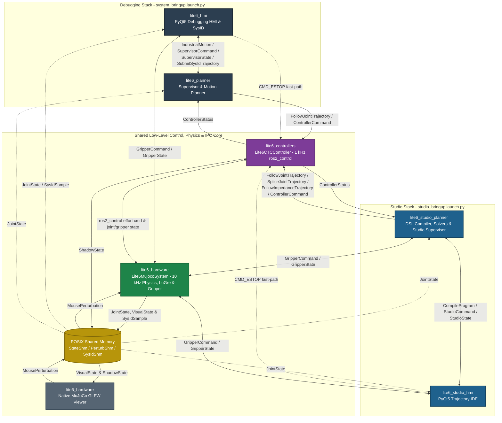

### Package Overview (`src/`)

| Package | Role |
| :--- | :--- |
| `lite6_interfaces` | Frozen ROS 2 `.msg` / `.srv` / `.action` contract, motion/compliance validation headers, and C++/Python lock-free POSIX shared-memory IPC (`shm_registers.hpp`, `shm_bridge.cpp`). |
| `lite6_description` | URDF models (full 8-DOF dynamics and 6-DOF planning envelope), MuJoCo XML scene and robot model, visual/collision meshes, and model generation utilities. |
| `lite6_kinematics` | Shared analytical 8-branch IK with local numerical correction and FK residual verification, Pinocchio forward kinematics and singularity checks, Coal collision engine, and kinematic limits configuration. |
| `lite6_hardware` | 10 kHz MuJoCo `ros2_control` hardware interface, LuGre dynamic friction, independent wide-gripper controller, and standalone native GLFW/OpenGL viewer. |
| `lite6_controllers` | 1 kHz `Lite6CTCController` unifying rigid CTC, `SYS_ID`, joint/Cartesian impedance, drag teaching, time-varying Cartesian impedance trajectory tracking, and E-STOP braking. |
| `lite6_studio_planner` | Custom DSL parser, 5-stage program compiler, C³ blending, 3rd-order TOPP, native 3rd-order OTG/S-curve/Joint-PVA/Cartesian-Collocation solvers, pause splicing, and Studio Supervisor. |
| `lite6_studio_hmi` | PyQt5 Trajectory Programming IDE with DSL syntax highlighting, preset examples, clickable diagnostics, live line highlighting, execution controls, and telemetry monitors. |
| `lite6_planner` | Debugging planner adapter (backed by `lite6_studio_planner::ProgramCompiler`) and event-driven DES/SCT Supervisor for manual moves, compliance, and friction identification. |
| `lite6_hmi` | PyQt5 Debugging HMI for manual MoveJ/P/L/C, interactive compliance & drag teaching with encoder recording, automated Fourier friction identification, payload, and gripper controls. |
| `lite6_bringup` | Launch orchestration for the Debugging stack (`system_bringup.launch.py`) and the Studio stack (`studio_bringup.launch.py`). |

## CTC Controller Architecture (NORMAL Mode)

In `NORMAL` mode, `Lite6CTCController` executes at 1 kHz (`dt = 1 ms`), consuming the latest due 1 kHz zero-order-hold (ZOH) trajectory sample (`q_d`, `dq_d`, `ddq_d`) and measured encoder states (`q`, `dq`) to form tracking errors `e = q_d - q` and `de = dq_d - dq`. The raw joint effort `tau_raw` sums four core terms: **Pinocchio RNEA inverse dynamics** (evaluated over the full 8-DOF articulated state `Q`, `V` with zero assumed gripper acceleration and an online smoothed payload inertia model on `joint6`), **rotor inertia (armature) compensation**, **reference-velocity viscous and smoothed Coulomb friction feedforward**, and a **torque-domain integrator with back-calculation anti-windup**, before clamping to actuator torque limits `±tau_max`:

<p align="center">
  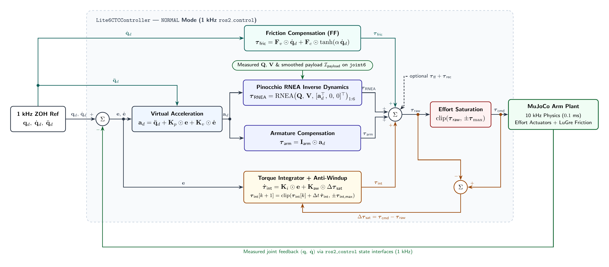
</p>

In the diagram above, `⊙` denotes element-wise multiplication, `Q` and `V` stack the six arm states and two measured gripper finger states, `tau_ff` is an optional trajectory-point torque feedforward term, and `tau_rec` is a cosine-decaying bias used only during bumpless mode handovers back into `NORMAL` (paired with transition-window torque slew limiting and slew-aware anti-windup). When `SetPayload` updates the carried mass and center of mass, the controller exponentially filters the mass and static first moment on `joint6` and transfers the resulting gravity delta out of `tau_int` to prevent torque steps. In `SYS_ID` mode, friction compensation and integral action are disabled while RNEA and armature compensation remain active; during `ESTOP` and `COMPLIANCE_STOPPING`, friction feedforward is turned off so physical friction aids passive braking while the integrator freezes error accumulation and continues back-calculation anti-windup.

## Robot Trajectory Programming Language (DSL) Syntax

The Studio stack (`lite6_studio_planner` + `lite6_studio_hmi`) compiles and executes programs written in a dedicated robotic trajectory **Domain-Specific Language** (`.l6` scripts). The compiler runs five deterministic stages: lexing/parsing, semantic validation, trajectory planning, 1 kHz kinematic limit verification, and Coal collision checking, before authorizing execution.

### Lexical Rules and Resource Budgets

* **Comments & delimiters:** Line comments begin with `#` and run to the end of the line. Statements are separated by newlines or optional semicolons (`;`). Whitespace is ignored, except that optional angle-unit suffixes (`rad` or `deg`) must appear on the **same line** immediately following the numeric literal or vector they modify.
* **Identifiers & literals:** Identifiers match `[A-Za-z_][A-Za-z0-9_]*` and are case-sensitive. Reserved keywords (`Pose`, `joint`, `pose`, `MoveJ`, `MoveP`, `MoveL`, `MoveC`, `MovePVA`, `ImpedanceCartesian`, `Gripper`, `Wait`, `SetPayload`, `point`, `rad`, `deg`, `true`, `false`, `JOINT`, `CARTESIAN`, `OPEN`, `CLOSE`, `STOP`) cannot be reused as constant names. Numeric literals accept signed decimal and scientific notation (`e`/`E`) and must be finite.
* **Compiler budgets:** Maximum `256 KiB` source size, `16,384` lines, `65,536` tokens, `2,048` statements, `256` waypoints per `MovePVA` block, `512` compiled execution blocks, `180,000` 1 kHz samples per program, and `64` reported diagnostics.

### Typed Constant Declarations

Top-level single-assignment constants (redefinition or type mismatch is rejected at compile time) define reusable joint targets and Cartesian poses:

* **Joint constant:** `joint NAME = [j1, j2, j3, j4, j5, j6] [rad|deg]` (defaults to `rad`).
* **Pose constant:**
  * Explicit form with Euler RPY: `pose NAME = Pose(xyz=[x, y, z], rpy=[r, p, y] [rad|deg])` (intrinsic ZYX / extrinsic XYZ: `Rz(y) * Ry(p) * Rx(r)`).
  * Explicit form with quaternion: `pose NAME = Pose(xyz=[x, y, z], quat=[qx, qy, qz, qw])` (vector-first order, must be unit-normalized within `1e-2`).
  * 6-vector shorthand: `pose NAME = [x, y, z, r, p, y] [rad|deg]`.
  * All Cartesian positions `xyz` are in meters and bounded to `[-10.0, 10.0] m`.

### Common Motion Options

Motion commands accept optional named scaling and corner-blending arguments:

* `vel` in `[0.01, 1.0]` (default `0.5`), `acc` in `[0.01, 1.0]` (default `0.5`), and `jerk` in `[0.01, 1.0]` (default `1.0`) scale the joint/Cartesian kinematic limits.
* `blend` in `[0.0, 0.5]` m (default `0.0`) inserts C³-continuous degree-7 Bernstein/Bézier corner blends between consecutive compatible motion segments. Cartesian groups (`MoveL`/`MoveC`) cap the trim distance at **42%** of each adjacent segment length. Joint groups (`MoveJ`/`MoveP`) convert the requested TCP pseudo-arc-length into joint-space trims, cap each trim at **45%** of its adjacent joint segment length, and use the smaller trim symmetrically. Reduced effective blend distances produce `WARN_BLEND_CLAMPED`; unusable blends at motion-group boundaries produce `WARN_BLEND_IGNORED`. Near-reversal corners can be rejected instead of blended.

### Executable Statements

| Statement | Syntax | Semantics & Constraints |
| :--- | :--- | :--- |
| **`MoveJ`** | `MoveJ([target=]<joint>, [vel, acc, jerk, blend])` | Synchronized joint-space point-to-point motion. Accepts a `joint` constant or 6-vector `[rad\|deg]`. |
| **`MoveP`** | `MoveP([target=]<pose>, [vel, acc, jerk, blend])` | Solves analytical IK for the Cartesian target pose and executes in joint space (TCP path not constrained to a line). |
| **`MoveL`** | `MoveL([target=]<pose>, [vel, acc, jerk, blend])` | Straight-line TCP translation and orientation interpolation along a continuous IK branch. |
| **`MoveC`** *(3-point)* | `MoveC(via=<xyz\|pose>, target=<pose>, [vel, acc, jerk, blend])` | Circular TCP arc through the positions of start, `via` (`[x, y, z]` or full 6-DOF pose), and `target`. Only the XYZ portion of `via` is used; its orientation is ignored, and orientation interpolates from start to target. A differing via orientation can produce `WARN_MOVEC_VIA_ORI_IGNORED`. All arguments are named. |
| **`MoveC`** *(center-angle)* | `MoveC(center=[cx,cy,cz], axis=[ax,ay,az], angle=<val> [rad\|deg], [target_ori=<pose>, vel, acc, jerk, blend])` | Circular arc about `center` and non-zero `axis` over sweep `0 < \|angle\| <= 2*pi` rad (with optional `target_ori`). |
| **`MovePVA`** | `MovePVA(space=JOINT\|CARTESIAN, [vel, acc, jerk]) { point(p=..., [v=[...], a=[...], dt=...]) ... }` | Multi-waypoint trajectory block (`>= 1` `point(...)` entries). Each point allows `(P)`, `(P, V)`, or `(P, V, A)` (`a` requires `v`), plus optional segment duration `dt` in `(0.005, 120.0]` s, rounded to the nearest 1 ms before being imposed as a fixed duration. Every block ends at rest; non-zero final `v`/`a` are clamped to zero with `WARN_PVA_FINAL_NONZERO_VA`. In `CARTESIAN` space, `v` is the `LOCAL_WORLD_ALIGNED` twist `[vx, vy, vz, wx, wy, wz]` and `a` is `[ax, ay, az, alphax, alphay, alphaz]`. |
| **`ImpedanceCartesian`** | `ImpedanceCartesian([kt, dt\|zeta_t, kr, dr\|zeta_r, null_damping, transition_time, wrench_ff, hold]) { ... }` | Scoped compliant Cartesian trajectory block (non-empty). `kt` (`[0, 1000]` N/m, default `250`), `dt`/`zeta_t` (`[0.1, 2.0]`, default `0.8`), `kr` (`[0, 50]` Nm/rad, default `10`), and `dr`/`zeta_r` (`[0.1, 2.0]`, default `0.8`) accept a scalar or `[x, y, z]`; `null_damping` in `[0, 20]` (default `0.15`), `transition_time` in `[0.01, 5.0]` s (default `0.15`), `wrench_ff` in `LOCAL_WORLD_ALIGNED` (`\|F\| <= 30` N, `\|tau\| <= 5` Nm), `hold=false\|true` (default `false` returns to `NORMAL`). Permits only `MoveL`, `MoveC`, `MovePVA(space=CARTESIAN)`, `Gripper`, `Wait`, and `SetPayload` inside its body (joint-space moves, nested impedance blocks, and declarations are rejected). |
| **`Gripper`** | `Gripper([action=]OPEN\|CLOSE\|STOP, [wait=true\|false, timeout=<sec>])` | Controls the decoupled wide gripper; defaults `wait=true`, `timeout=6.0` s (range `(0.1, 30.0]` s). |
| **`Wait`** | `Wait([duration=]<sec>)` | Stationary dwell in `(0.0, 120.0]` s. |
| **`SetPayload`** | `SetPayload([mass=]<kg>, [com=[x, y, z]])` | Updates online carried mass in `[0.0, 0.6]` kg and TCP-frame CoM offset with `\|\|com\|\| <= 0.30` m (default `[0, 0, 0]`). |

The final-rest rule applies to both `JOINT` and `CARTESIAN` `MovePVA` blocks. Use interior waypoints within one block for non-zero waypoint velocities; separate blocks do not preserve a non-zero boundary velocity. For example, `dt=1.2344` requests an effective segment duration of `1.234 s`, subject to trajectory feasibility.

`ImpedanceCartesian` applies its settings to each compiled impedance motion block. With `hold=true`, a successfully completed impedance trajectory enters Cartesian impedance hold; the Studio executor returns to `NORMAL` before the next rigid or impedance trajectory, when entering a paused state, and when the program completes. This option does not keep the controller in impedance mode indefinitely after program completion.

### `.l6` Program Example

```text
# Typed constant declarations (rad is default; deg is also supported)
joint READY = [0.0, 20.0, 60.0, 0.0, 40.0, 0.0] deg
pose ABOVE  = Pose(xyz=[0.240, -0.150, 0.160], rpy=[3.14159, 0.0, 0.0])

SetPayload(mass=0.0)
MoveJ(READY, vel=0.8, acc=0.8)
Gripper(action=OPEN, wait=true)

# Blended Cartesian approach and circular arc
MoveL(ABOVE, vel=0.8, acc=0.8, blend=0.025)
MoveC(via=[0.320, 0.000, 0.180], target=Pose(xyz=[0.240, 0.120, 0.160], rpy=[3.14159, 0.0, 0.0]), vel=0.8, acc=0.8)

# Scoped Cartesian impedance descent (soft Z-axis stiffness)
ImpedanceCartesian(kt=[450, 450, 100], dt=0.85, kr=[25, 25, 18], dr=0.85, hold=false) {
  MoveL(Pose(xyz=[0.240, 0.120, 0.120], rpy=[3.14159, 0.0, 0.0]), vel=0.3, acc=0.3)
}
Wait(duration=0.1)
```

## Demonstrations

### 1. Studio Demonstration Trajectories

These four recordings showcase the **Studio Version** (`studio_bringup.launch.py`), pairing the native MuJoCo viewer on the left with the PyQt5 Trajectory Programming IDE on the right.

#### Demo 1: 10-Point Full-Workspace Cartesian PVA Trajectory

Compiles and executes a 10-waypoint `MovePVA(space=CARTESIAN)` script specifying 6-DOF TCP poses, world-aligned spatial twists, and classical linear/angular accelerations spanning the front, left, rear (`-X`), right, and high-overhead (`z` up to `0.63 m`) workspace before coming smoothly to rest. The adaptive cubic joint-space collocation solver verifies joint/Cartesian kinematic limits on the 1 kHz sampled trajectory, and Coal checks collision freedom at each sample with joint-space subdivision where needed. Singularity constraints are checked during planning; sampled singularity validation runs every 5 ms in the collocation solver and every 10 ms in the common trajectory verifier, with both also checking the endpoint.

<p align="center">
  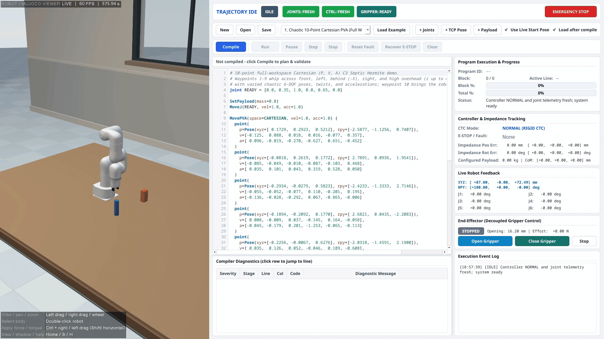
</p>

#### Demo 2: 10-Point Full-Workspace Joint PVA Trajectory

Compiles and executes a high-speed 10-waypoint `MovePVA(space=JOINT)` script with explicit six-axis positions, velocities, and accelerations across all joints. The custom native third-order bounded-position OTG and joint-space PVA solver generate synchronized jerk-limited 1 kHz transitions respecting hard joint position, velocity, acceleration, and jerk bounds.

<p align="center">
  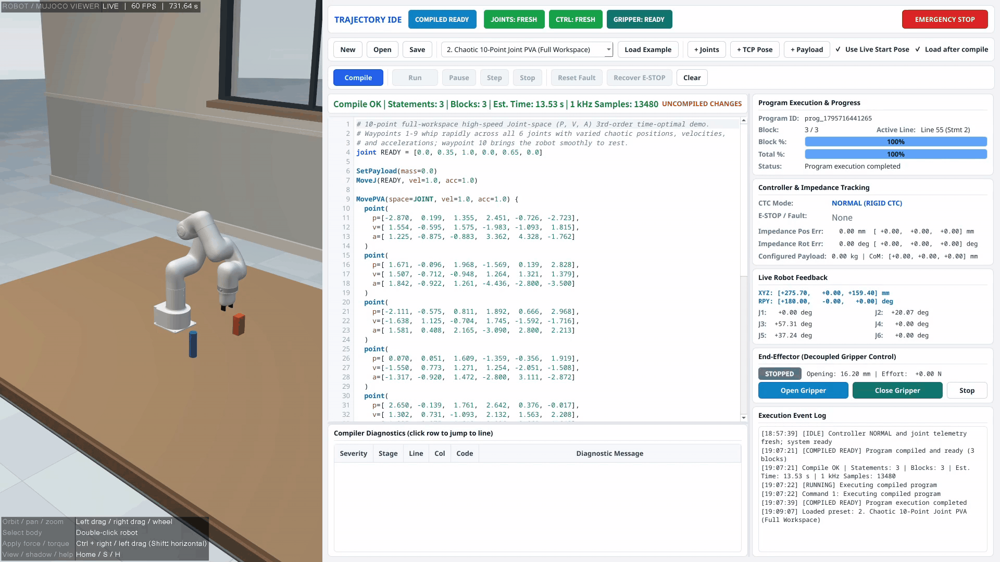
</p>

#### Demo 3: Horizontal Cartesian Path Blending (Stop-and-Go vs. Smooth C³ Blending)

Directly contrasts exact stop-and-go execution (`blend=0`) against continuous C³ corner blending (`blend=0.025`) over an identical horizontal-plane (`z = 0.250 m`) route combining a multi-segment `MoveL` zigzag and a wide `MoveC` arc. In the first loop, the TCP comes to a full stop at every vertex; in the second loop, degree-7 Bernstein/Bézier corner blends and third-order TOPP parameterization carry the manipulator smoothly through the entire path in one continuous motion.

<p align="center">
  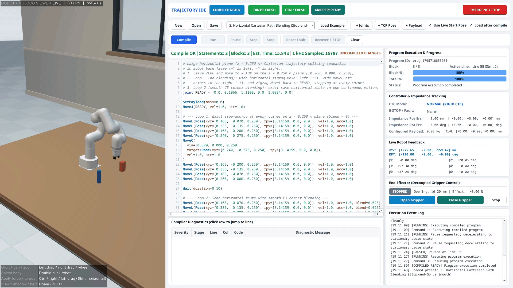
</p>

#### Demo 4: Full Compliant Pick, Stack, and Side-Grasp Manipulation Sequence

Demonstrates a complete multi-stage physical manipulation task with two 300 g free rigid objects on the workbench: the robot opens the wide gripper, picks the 300 g blue cylinder, updates the real-time dynamic payload (`SetPayload(mass=0.30)`), blends a `MoveL` lift into a `MoveC` arc above the 300 g orange box, switches into a scoped `ImpedanceCartesian(...)` block to seat the cylinder gently on top of the box with intentional compliant yielding, releases and resets payload, arcs around to side-grasp the bottom box supporting the stacked cylinder (`SetPayload(mass=0.60)`), swings the 600 g stack across a vertical `MoveC` arc, sets the stack back onto the tabletop compliantly via `ImpedanceCartesian`, releases, and returns to `ZERO`.

<p align="center">
  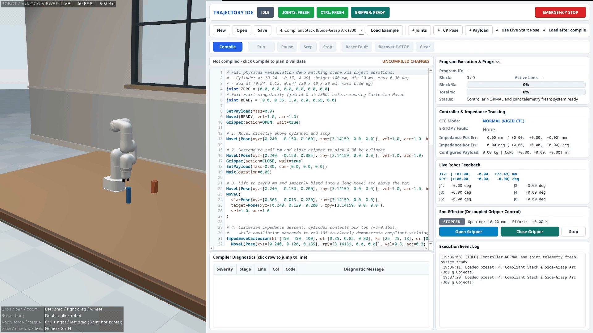
</p>

---

### 2. Debugging Version: Encoder-Based Compliance and Drag Teaching

These three recordings demonstrate the core compliance capabilities in the **Debugging Version** (`system_bringup.launch.py`) under the `Compliance / Teaching` tab. All interaction forces are applied live in the native MuJoCo viewer using mouse spring perturbations (`Ctrl + right drag` for force, `Ctrl + left drag` for torque); the controller uses only joint encoders and the Pinocchio dynamics model.

#### Cartesian-Space Impedance

The controller captures the current `link_eef` equilibrium pose and enforces world-aligned translational and rotational stiffness (`500 N/m`, `50 Nm/rad`) with equal-damping-ratio scaling (`0.80`) computed from diagonal operational-space effective inertia, plus passive M-weighted nullspace damping (`0.50 Nm·s/rad`). External mouse disturbances compliantly deflect the TCP and smoothly return it to equilibrium upon release.

<p align="center">
  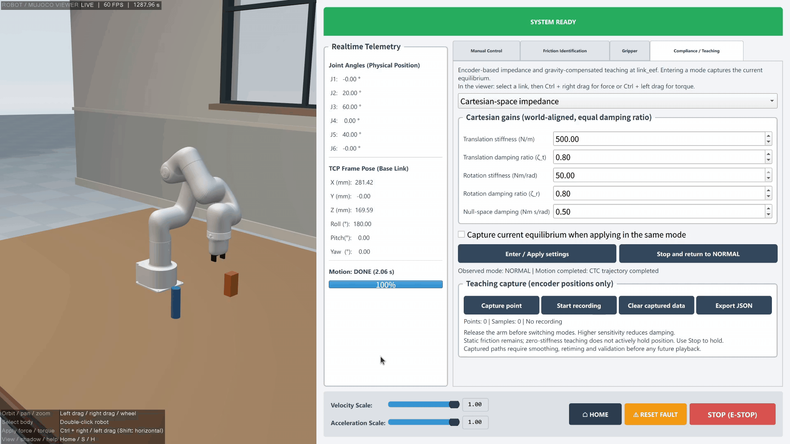
</p>

#### Drag Teaching (`diag(M)`-Normalized)

With zero position stiffness, full gravity compensation, and inertia-normalized per-joint velocity damping scaled by the sensitivity level (`1 = firm` to `5 = light`), the manipulator can be guided freely throughout the workspace by mouse drag forces and comes cleanly to rest wherever released, ready for encoder waypoint capture or 100 Hz JSON trajectory recording.

<p align="center">
  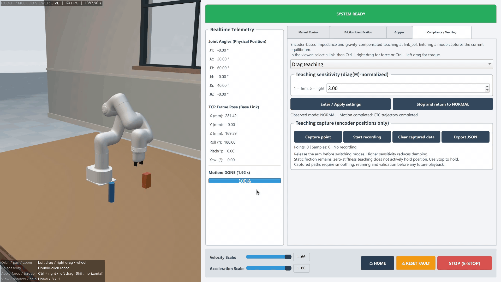
</p>

#### Joint-Space Impedance

Enforces independent per-joint virtual springs and dampers (`100 Nm/rad`, `10 Nm·s/rad`) around the captured equilibrium configuration alongside gravity compensation and soft joint-limit walls, smoothly absorbing external link perturbations and restoring the captured joint posture.

<p align="center">
  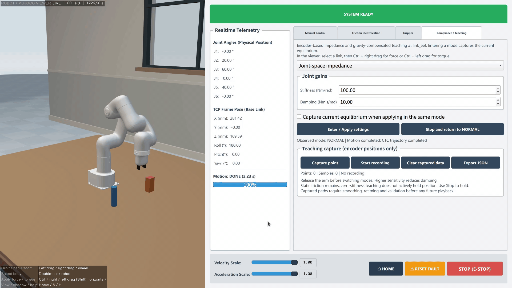
</p>

---

### 3. Studio IDE: Pausing and Resuming Trajectories

During rigid trajectory execution, as shown in this Cartesian PVA program, clicking **Pause** normally invokes `/ctc_controller/splice_joint_trajectory` with a path-preserving septic time-scaling deceleration tail. If insufficient path remains, the active block may finish before pausing. If the service is unavailable, splice planning fails, or adoption cannot be confirmed, execution falls back to goal cancellation and reconciles any uncertain splice outcome. The cancellation fallback does not guarantee preservation of the original geometric path. After a mid-block pause, **Resume** replans the remaining portion from the measured paused state and continues if replanning and validation succeed; a replanning failure is reported as a fault. Impedance trajectories use cancellation and return to `NORMAL` for pausing rather than rigid trajectory splicing.

<p align="center">
  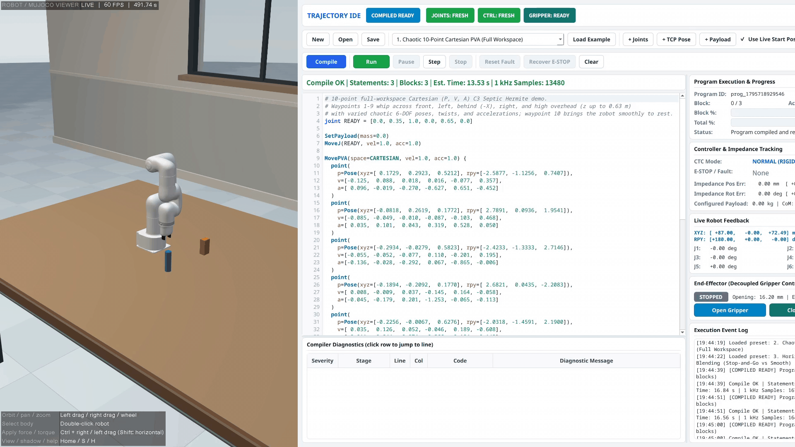
</p>

---

### 4. Diagnostics, Warnings, Fault Handling, and Supervised Recovery

Both the Studio IDE and the Debugging HMI surface deterministic pre-execution diagnostics and runtime safety interlocks rather than silently permitting invalid or unsafe motion.

#### Studio IDE Compilation Warning

When a DSL script requests a blend radius that exceeds the geometric limit of an adjacent segment, the compiler clamps it safely, completes compilation (`Compile OK | Warnings: 1`), highlights the relevant line in amber, and logs a clickable `WARN_BLEND_CLAMPED` diagnostic in the Compiler Diagnostics table.

<p align="center">
  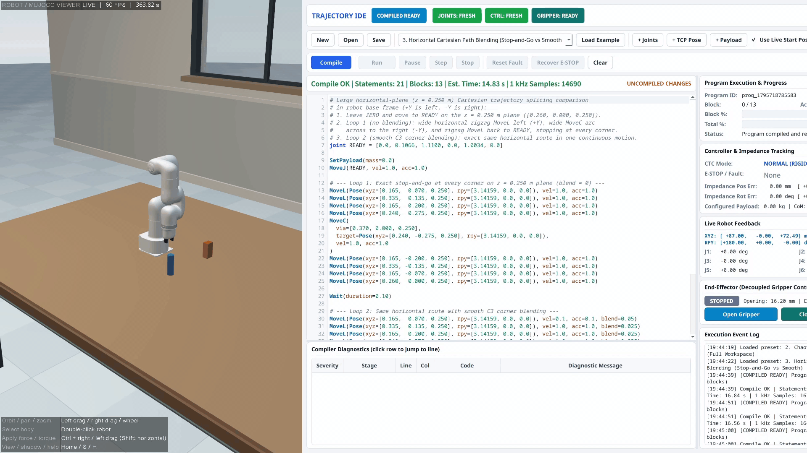
</p>

#### Studio IDE Compilation Error

When a Cartesian path encounters an analytical IK branch discontinuity (`ERR_QUADRANT_JUMP`), singularity, kinematic violation, or collision during compilation, the five-stage compiler rejects the program before execution (`Compile FAILED`), highlights the offending line in red, and reports the stage, line number, error code, and exact path progress.

<p align="center">
  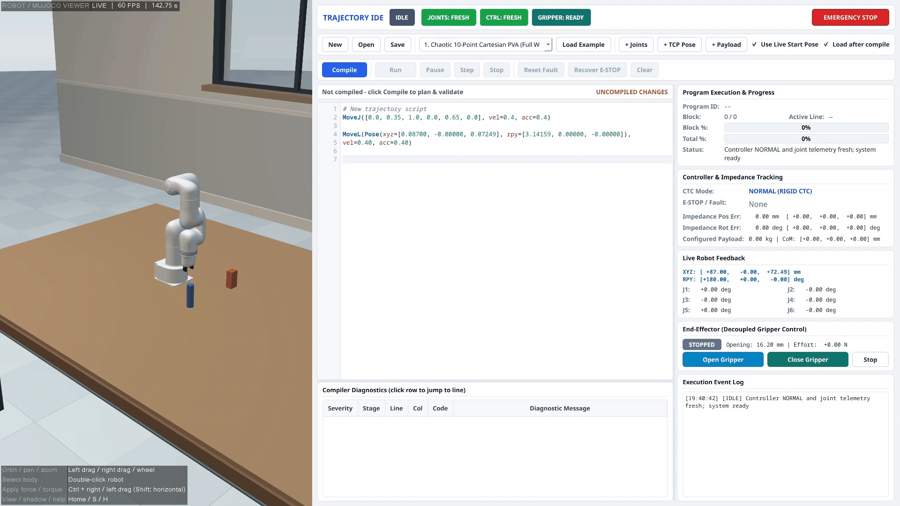
</p>

#### Debugging HMI Pre-Execution Collision Rejection

Commanding a `MoveJ` target that causes self-collision is intercepted by the Coal collision checker before any trajectory is sent to the controller, turning the status banner orange with the exact colliding link pair (`Collision between link_base_0 and link5_0`).

<p align="center">
  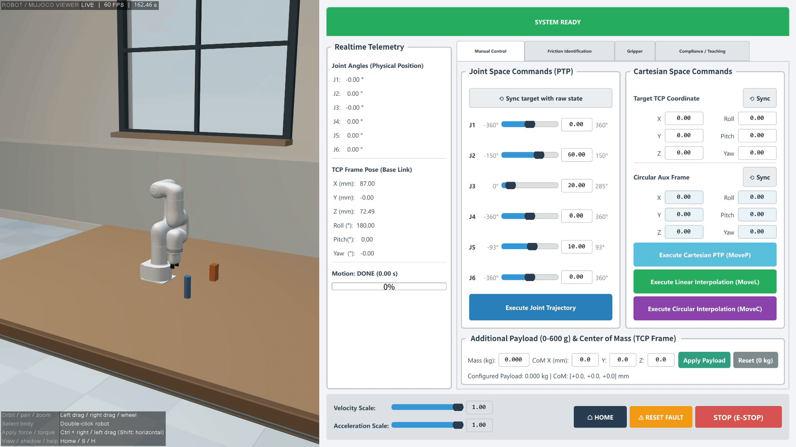
</p>

#### Runtime Collision Fault (CTC E-STOP) and Supervised Recovery

If the arm collides unexpectedly with a physical object on the workbench during rigid execution (here descending into the rigid cylinder, which is intentionally outside the static planning model), the 1 kHz CTC monitor immediately latches `MODE_ESTOP` upon exceeding path velocity tolerance (`joint2 path velocity error exceeded: 0.618 rad/s > 0.500 rad/s`), halts the arm via its closed-loop deceleration tracker, and raises the red fault banner. Clicking **RESET FAULT** runs the supervised recovery sequence (`CMD_CLEAR_ESTOP` once stationary) to restore `SYSTEM READY`, after which normal motion resumes.

<p align="center">
  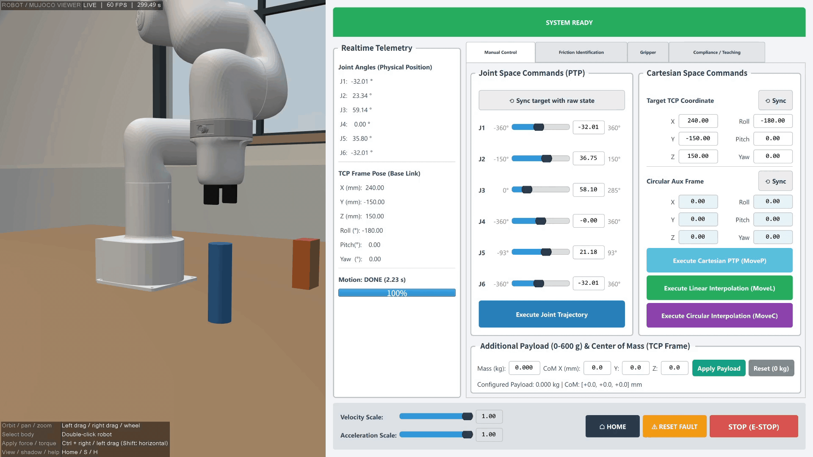
</p>

---

### 5. Debugging HMI: Basic Motion, Grasping, and Automated Friction Identification

These four recordings illustrate the core everyday capabilities of the **Debugging Version** (`lite6_hmi`).

#### Standard Joint-Space Motion (`MoveJ`)

Adjusting target joint angles in the `Manual Control` tab and executing a synchronized jerk-limited joint-space trajectory while monitoring real-time joint angles, TCP pose, and progress feedback.

<p align="center">
  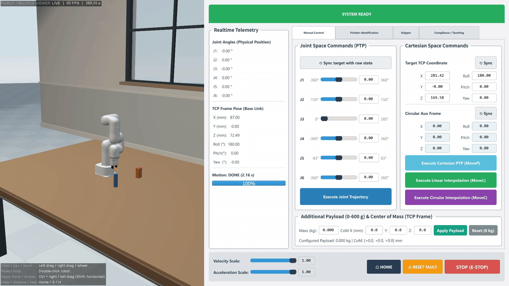
</p>

#### Standard Linear Cartesian Motion (`MoveL`)

Specifying a target TCP pose (`X, Y, Z, Roll, Pitch, Yaw`) and executing a straight-line Cartesian trajectory above the workbench object with continuous IK branch verification.

<p align="center">
  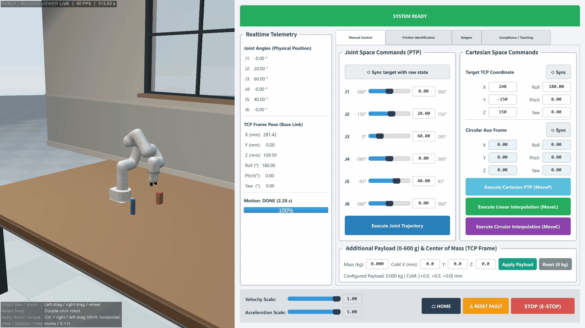
</p>

#### Physical Grasping and Live Payload Compensation

Descending linearly around the 300 g cylinder, closing the independent wide gripper from the `Gripper` tab, applying `0.300 kg` via the `Additional Payload` panel so Pinocchio updates the wrist inertia online, and lifting the cylinder cleanly.

<p align="center">
  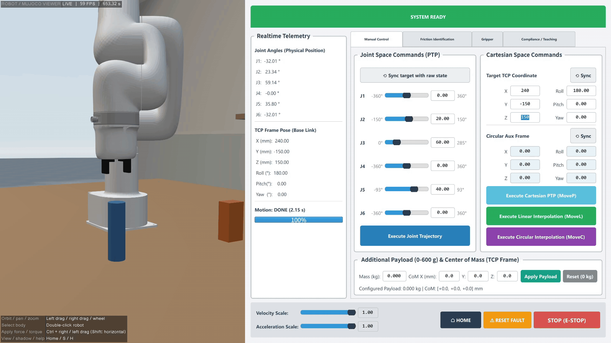
</p>

#### Automated Friction Identification (`SYS_ID`)

Running the automated friction identification workflow from the `Friction Identification` tab: the engine synthesizes a bounded 7-harmonic Fourier excitation trajectory, verifies self and ground collision clearance, aligns the arm, switches the controller into frictionless/zero-integral `SYS_ID` mode, streams physical telemetry over the lock-free POSIX SHM ring buffer, and fits per-joint viscous and Coulomb parameters via bounded least squares on generalized momentum integrals (avoiding numerical acceleration differentiation), producing `friction_v_nominal`, `friction_c_nominal`, and per-joint fit residuals for review before copying the parameters into `ros2_controllers.yaml`. Residuals depend on the excitation and recorded data; no fixed residual bound is guaranteed.

<p align="center">
  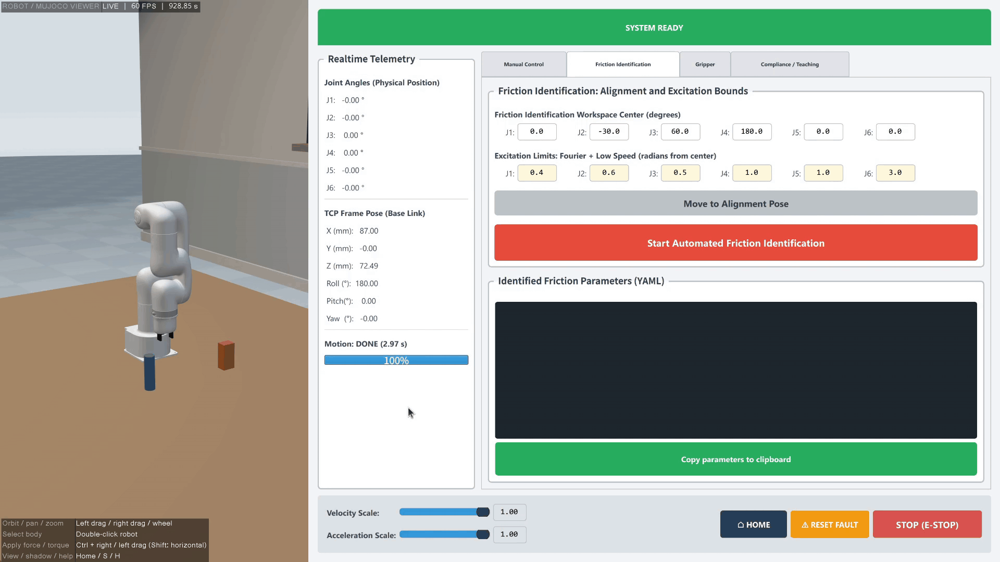
</p>

---

### 6. Shadow Robot Visualization

The native MuJoCo viewer supports a toggleable translucent cyan **shadow robot** (press `S` inside the viewer window, or launch with `viewer_shadow:=true`). The shadow robot is a pure kinematic target overlay driven directly by `ShadowStatePod` written into POSIX shared memory by the 1 kHz `Lite6CTCController`. It represents the controller's live desired joint trajectory in real time, whereas the opaque physical arm displays the actual simulated dynamics responding to inertia, gravity, LuGre friction, payloads, contacts, and interactive mouse spring forces, making tracking performance, compliant deflection, and disturbance rejection immediately visible without modifying or doubling the physics simulation.

## Reproduction Guide

### Environment & Bundled MuJoCo

* **Target platform:** Ubuntu 24.04 on Linux **x86-64**, ROS 2 Jazzy, C++17, Python 3.12, and an OpenGL-capable graphical desktop for the viewer and HMIs. The bundled MuJoCo shared library is an x86-64 binary; other architectures require a matching MuJoCo build and are not covered by this reproduction guide.
* **No container image provided:** Because this repository is relatively large, I do not distribute a prebuilt container image. However, if you prefer not to modify your host system environment, I encourage running the project inside **Distrobox** or **Docker**. Please note that GPU/OpenGL forwarding, X11/Wayland display access, or `SCHED_FIFO` thread-priority permissions may introduce compatibility issues depending on your host configuration.
* **Bundled MuJoCo 3.9.0:** The `mujoco-3.9.0/` directory is included directly in the repository root for convenience and is completely identical to the official MuJoCo 3.9.0 release. Newer versions (`> 3.9.0`) may also work, but I recommend sticking with the bundled `3.9.0` build if you encounter compilation or runtime issues.

### 1. Configure ROS 2 and MuJoCo Environment Variables

Run all commands below from the repository root so that CMake and the dynamic linker can locate the MuJoCo engine:

```bash
source /opt/ros/jazzy/setup.bash
export MUJOCO_DIR="$PWD/mujoco-3.9.0"
export LD_LIBRARY_PATH="$MUJOCO_DIR/lib${LD_LIBRARY_PATH:+:$LD_LIBRARY_PATH}"
```

### 2. Install Dependencies via `rosdep`

```bash
# If rosdep has never been initialized on your machine, run once:
# sudo rosdep init
rosdep update
rosdep install --from-paths src --ignore-src -r -y
```

### 3. Clean Build

Always remove `build/`, `install/`, and `log/` before rebuilding the ROS 2 workspace to prevent stale cache issues:

```bash
rm -rf build install log
colcon build --symlink-install
source install/setup.bash
```

### 4. Launch the Simulation Stack

Choose either the **Debugging Version** or the **Studio Version** (do not launch both simultaneously, as they share the same hardware/controller stack):

```bash
# Launch the Debugging Version (Debugging HMI + Supervisor + CTC + MuJoCo Viewer)
ros2 launch lite6_bringup system_bringup.launch.py

# OR launch the Studio Version (Trajectory Programming IDE + DSL Compiler/Planner + CTC + MuJoCo Viewer)
ros2 launch lite6_bringup studio_bringup.launch.py
```

Useful optional launch arguments for both bringup files: `viewer:=false` (disable only the 3D viewer; the HMI still starts), `viewer_shadow:=true` (enable the cyan shadow robot on startup), `viewer_shadows:=true` (enable cast shadows), and `viewer_fps:=60` (15–240 Hz).

The Studio bringup also supports `gui:=false`. To run it without either graphical window:

```bash
ros2 launch lite6_bringup studio_bringup.launch.py viewer:=false gui:=false
```

The Debugging bringup currently starts its PyQt5 HMI unconditionally and has no `gui` launch argument.

In the native MuJoCo viewer, double-click a link to select it, hold `Ctrl + right drag` to apply a spring force or `Ctrl + left drag` for torque, press `S` to toggle the shadow robot, `Home` to reset the camera, and `H` to toggle the on-screen help overlay.

## Keywords

ROS 2, ROS 2 Jazzy, ros2_control, MuJoCo, Pinocchio, Coal, HPP-FCL, PyQt5, C++17, Python, six-axis robotic arm, 6-DOF manipulator, robot simulation, physics simulation, motion planning, trajectory planning, trajectory optimization, time-optimal path parameterization, TOPP, jerk-limited trajectory generation, third-order online trajectory generation, OTG, S-curve, double-S velocity profile, Cartesian path planning, joint-space path planning, MoveJ, MoveP, MoveL, MoveC, MovePVA, C3 corner blending, Bernstein Bezier spline, SO(3) Lie algebra spline, direct collocation, interior point method, IPM, trajectory splicing, pause and resume, analytical inverse kinematics, closed-form IK, singularity avoidance, collision detection, computed torque control, CTC, inverse dynamics, RNEA, rotor inertia compensation, armature compensation, dynamic payload compensation, torque-domain integral control, back-calculation anti-windup, compliance control, impedance control, joint impedance control, Cartesian impedance control, operational space control, nullspace damping, drag teaching, gravity compensation, encoder-only compliance, LuGre dynamic friction, Stribeck friction, friction compensation, friction identification, system identification, Fourier excitation trajectory, generalized momentum integral, finite-state machine, discrete event system, DES, supervisory control theory, SCT, supervisory control, software emergency stop, fault recovery, robotic domain-specific language, robot programming IDE, POSIX shared memory, lock-free IPC, SeqLock, SPSC ring buffer, shadow robot, wide gripper simulation, mouse perturbation

ROS 2，ROS 2 Jazzy，ros2_control，MuJoCo，Pinocchio，Coal，HPP-FCL，PyQt5，C++17，Python，六轴机械臂，六自由度机械臂，机器人仿真，物理仿真，运动规划，轨迹规划，轨迹优化，时间最优路径参数化，TOPP，加加速度受限轨迹生成，三阶在线轨迹生成，OTG，S型速度规划，七段S曲线，笛卡尔空间规划，关节空间规划，MoveJ，MoveP，MoveL，MoveC，MovePVA，C3拐角平滑过渡，贝塞尔样条，SO(3)李代数样条，直接配点法，内点法，轨迹拼接，暂停与恢复，解析逆运动学，封闭解逆解，奇异性检测，碰撞检测，计算力矩控制，CTC，逆动力学，递归牛顿欧拉算法，RNEA，转子惯量补偿，动态负载补偿，力矩域积分控制，抗积分饱和，柔顺控制，阻抗控制，关节空间阻抗控制，笛卡尔空间阻抗控制，操作空间控制，零空间阻尼，拖动示教，重力补偿，无力矩传感器柔顺控制，LuGre动态摩擦模型，Stribeck摩擦，摩擦补偿，摩擦辨识，系统辨识，傅里叶激励轨迹，广义动量积分，有限状态机，离散事件系统，监督控制理论，监督控制，软件急停，故障恢复，机器人领域特定语言，轨迹编程IDE，POSIX共享内存，无锁进程间通信，影子机器人，平行夹爪仿真，鼠标外力扰动交互

## Future Work

In future iterations of this project, I plan to focus on two main directions:

* **Improving system robustness:** Hardening edge-case handling across trajectory compilation, numerical solver convergence, dynamic pause/resume replanning, compliant contact transitions, and supervisory recovery under stress and host timing jitter.
* **Providing a detailed technical document:** Writing an updated, comprehensive technical report covering the mathematical formulations, numerical optimization details, controller derivations, friction modeling and identification equations, and software architecture across both the Debugging and Studio stacks.

## License and Third-Party Notices

The original code, documentation, and project-specific configuration authored for this repository are licensed under the **MIT License**; see [LICENSE](LICENSE). All ten project-authored ROS 2 packages under `src/` declare MIT, including the Python package metadata. Third-party code and model assets retain their upstream licenses, including assets distributed inside `lite6_description`.

| Bundled third-party resource | License and notices |
| :--- | :--- |
| MuJoCo 3.9.0 (`mujoco-3.9.0/`) | [Apache-2.0 license](mujoco-3.9.0/LICENSE); its incorporated dependencies have additional licenses recorded in [THIRD_PARTY_NOTICES](mujoco-3.9.0/THIRD_PARTY_NOTICES). |
| Lite6 model and mesh resources originating from MuJoCo Menagerie, including derived model assets in `lite6_description` | The bundled [BSD-3-Clause notice](src/lite6_description/mujoco/MENAGERIE_LICENSE) credits UFACTORY Inc.; retain that notice for these resources. The MIT declaration for project-authored code does not replace this asset license. |

External dependencies installed separately, including ROS 2, ros2_control, Pinocchio, Coal, Eigen, GLFW, PyQt5, NumPy, SciPy, yaml-cpp, and PyYAML, remain under their respective upstream licenses. The repository MIT license does not relicense those dependencies.

## Acknowledgements

I would like to sincerely thank the creators and maintainers of the open-source projects that this work builds upon:

* **[ROS 2](https://docs.ros.org/en/jazzy/)** and **[ros2_control](https://control.ros.org/)**
* **[MuJoCo](https://mujoco.org/)** and **[MuJoCo Menagerie](https://github.com/google-deepmind/mujoco_menagerie)**
* **[Pinocchio](https://stack-of-tasks.github.io/pinocchio/)**
* **[Coal (formerly HPP-FCL)](https://github.com/coal-library/coal)**
* **[Eigen](https://eigen.tuxfamily.org/)**
* **[GLFW](https://www.glfw.org/)**
* **[PyQt5](https://www.riverbankcomputing.com/software/pyqt/)**
* **[NumPy](https://numpy.org/)** and **[SciPy](https://scipy.org/)**
* **[yaml-cpp](https://github.com/jbeder/yaml-cpp)**

## Disclaimer

This is a personal, open-source project. I am not affiliated with, sponsored by, or endorsed by any commercial entities mentioned in this repository. All trademarks and registered trademarks are the property of their respective owners. The software is provided "as is", without warranty of any kind.

## Contact

If you have any questions about this repository, you can raise an issue or contact [](mailto:wtianyi947@gmail.com) directly.
