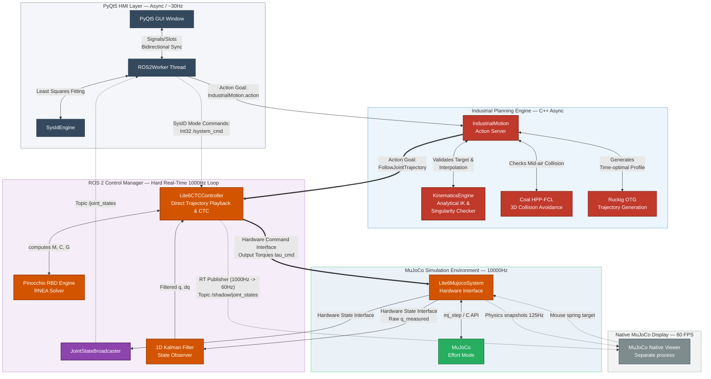
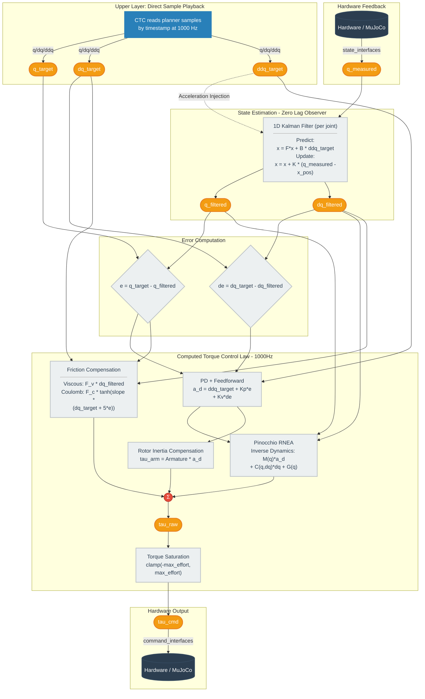
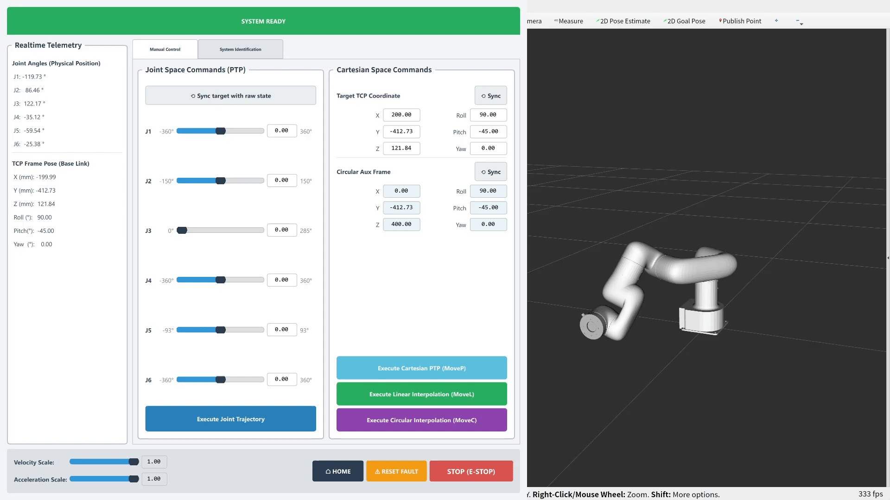
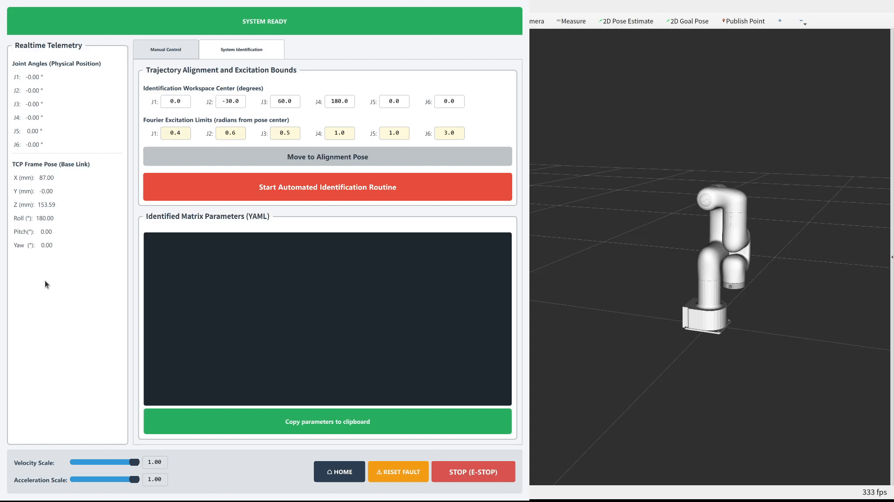
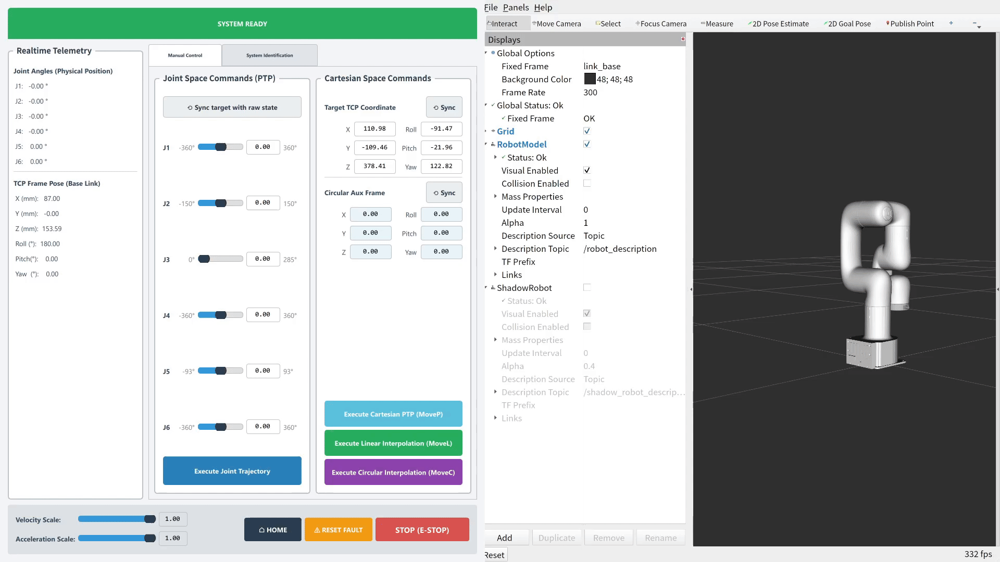
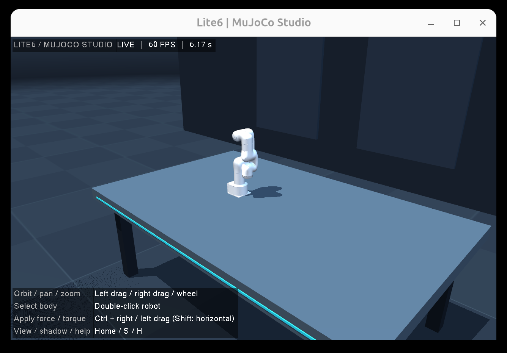

# Deterministic Motion Planning and Dynamics Control Framework for Lightweight 6-Axis Robotic Arms


This repository presents a high-fidelity, mathematically rigorous 6-axis robotic arm simulation and control framework. Initiated by an asynchronous and detailed GUI (based on PyQt5), the system orchestrates high-level motion using a **custom-built, deterministic, and thread-safe C++ planning engine**, bypassing standard frameworks like MoveIt2. This planner leverages a **closed-form Analytical Inverse Kinematics** solver (derived via Maple symbolic computation), combined with **Coal (formerly HPP-FCL)** for 3D collision avoidance and symbolic Jacobian determinant analysis for singularity detection. Trajectory generation is handled by **Ruckig** and **Closed-Loop Inverse Kinematics (CLIK)**. CLIK is combined with Jacobian pseudo-inverse (**Damped Least Squares**) and Quaternion **SLERP**. This provides time-optimal profiles for Joint Space (**MoveJ**), Cartesian Space (**MoveP**), Linear (**MoveL**), and Circular (**MoveC**) Cartesian motions.

At the core, a custom **Computed Torque Control (CTC)** controller based on **ros2_control** directly consumes sampled trajectories through `FollowJointTrajectory`, holding the latest due reference in its 1000Hz control loop without interpolation. To ensure physical realism, the CTC bypasses **MuJoCo**’s default PID joints to run the physics engine in pure **effort mode**. The CTC processes the feedback states via a **1D Kalman Filter** state observation model to reconstruct noise-free joint velocities, and executes **Pinocchio** dynamics calculations to compute rigid-body inertia, gravity, and Coriolis matrices. Combined with **friction/armature compensation** (smoothly neutralizing viscous damping, Coulomb stiction, and motor rotor inertia), this architecture achieves a tracking precision of $<0.01\text{ mm}$.

To bridge the gap between nominal simulation parameters and real-world physical discrepancies, an automated **system identification** (SysID) framework is integrated to extract joint-level viscous/Coulomb friction and motor armature coefficients, which are difficult to measure directly during manufacturing. Utilizing a bounded **Fourier excitation trajectory** coupled with an offline **Least-Squares solver**, the identified parameters align closely with the ground-truth physical properties defined in the URDF and MuJoCo XML files. Furthermore, the architecture incorporates a robust software emergency stop (E-Stop) and active recovery state machine. Upon triggering, it overrides high-level commands to execute precise, kinematic-limit-aware deceleration trajectories that safely halt the manipulator, while providing a seamless recovery sequence back to the active closed-loop tracking state.

To facilitate real-time diagnostics and visual verification of tracking performance, the framework incorporates a synchronized **"shadow robot"** virtual twin. This visualization layer is driven directly by the real-time C++ CTC controller via a lock-free `RealtimePublisher`. Press **S** in the native MuJoCo window to show the translucent cyan target robot. It renders the exact internal target commands (`q_target_`) at 1000Hz (published at 60Hz for the MuJoCo viewer), representing the manipulator's theoretical kinematic state under zero-disturbance conditions. The shadow robot depicts pure kinematic targets, while the closed-loop CTC controller forces the physical manipulator to overcome physical disturbances (gravity, Coriolis, joint friction, etc.) to track this reference.

For detailed mathematical derivations of the analytical IK and Jacobian matrices, please refer to [Kinematics.pdf](Kinematics.pdf).

For detailed mathematical derivations of the CTC controller and the SysID process, please refer to [Theory.pdf](Theory.pdf).

> ⚠️ **Notice:** The robot model used in this simulation is the **UFactory Lite6**, sourced from the official [MuJoCo Menagerie](https://github.com/google-deepmind/mujoco_menagerie). This repository is an independent open-source project designed for research and educational purposes.

<p align="center">
  
</p>


## 📑 Table of Contents
1. [System Architecture](#-system-architecture)
2. [Core Features & Demonstrations](#-core-features--demonstrations)
3. [Quick Start & Reproduction Guide](#-quick-start--reproduction-guide)
4. [Future Work](#-future-work)
5. [Acknowledgements](#-acknowledgements)
6. [Disclaimer](#-disclaimer)
7. [Contact](#-contact)


## 🧠 System Architecture
The system's architecture is illustrated in the diagram below:



The planner sends its complete sampled trajectory directly to `/ctc_controller/follow_joint_trajectory`. CTC holds the latest due position, velocity and acceleration sample without interpolation, and reports completion after consuming the final sample. Cancellation holds the measured position; the existing CTC emergency-stop deceleration remains unchanged.

The controller's architecture is shown in the diagram below:


## 🎥 Core Features & Demonstrations

### 1. Industrial Motion Planning (PTP, MoveL, MoveC)

*   **PTP (Point-to-Point):** Joint space planning (MoveJ) or Cartesian target planning (MoveP) utilizing the optimal inverse kinematic configuration.
<p align="center">
  
</p>

<p align="center">
  
</p>

*   **MoveL:** Deterministic linear Cartesian interpolation using SLERP for quaternion orientation and Jacobian pseudoinverse mapping.

<p align="center">
  
</p>

*   **MoveC:** Circular Cartesian interpolation using an auxiliary midpoint frame.

<p align="center">
  
</p>

### 2. Automated System Identification
The identification engine records actual joint position, velocity and actuator
effort during bounded Fourier excitation. Nonnegative linear least squares
identifies viscous `Fv` and Coulomb `Fc` friction using samples with
`|velocity| >= 0.05 rad/s`. The trajectory respects the entered excursion bounds,
joint motion limits and collision checks. Rigid-body torque and the known rotor
inertia are subtracted before fitting; rotor inertia and LuGre dynamic parameters
are not identified. LuGre friction simulation remains unchanged.

Identification uses `/simulation/sysid_samples`, a separate observational stream
containing the physical step number, simulation time, ROS-mapped step time,
position, velocity, applied effort, control period, physics lag and command age.
Repeated physical steps are removed before differentiation; ROS time only aligns
the experiment windows. Clock resets, inconsistent step timing, clock mapping
jumps over 5 ms and telemetry gaps fail validation. The existing `/joint_states`
stream and motion control remain unchanged. The extra stream is published only
while subscribed; the HMI subscribes during SysID.

Acceleration uses a 0.1 s Savitzky–Golay derivative. The first and last second
are excluded from fitting. Each axis requires at least 200 useful samples and
sufficient velocity variation. Output includes per-axis residuals and timing diagnostics.

Before estimation, raw experiments are saved as pickle-free `.npz` files in
`${ROS_HOME:-~/.ros}/lite6_sysid/`, with trajectory-window metadata and a companion
`.txt` result or failure report. The output displays the archive path. Files are
retained for diagnosis; archive errors are reported without interrupting the
controlled return to NORMAL.

SYS_ID endpoint tolerances are 0.04 rad and 0.005 rad/s, below the existing NORMAL
restoration guards (0.05 rad and 0.01 rad/s). Configuration rejects incompatible
SYS_ID tolerances. NORMAL endpoint tolerances, path protection, emergency stop,
reference playback and the Supervisor mode sequence retain their existing behavior.

CTC friction feedforward is
`Fv*dq + Fc*tanh(tanh_slope*(dq_target + friction_error_gain*position_error))`.
The existing direction smoothing and integral control remain unchanged; SYS_ID
mode still disables friction compensation.

The GUI output includes per-axis fit residuals and two YAML arrays:
`friction_v_nominal` (Nm·s/rad) and `friction_c_nominal` (Nm). Copy the arrays into
the CTC configuration and restart/reconfigure to apply them; identification does
not automatically change controller parameters.

SysID references use an exact 1 ms grid, matching the 1000 Hz CTC loop and
joint feedback. Trajectory generation and message construction run in the
background. The HMI immediately displays preparation progress (model loading,
Fourier collision checks, message construction and Supervisor acceptance)
and blocks duplicate starts and local manual motion requests during preparation.
This feedback does not change the robot mode: the Supervisor still authorizes
SysID after preflight. Dense-path checks deduplicate only exactly identical poses;
all distinct samples and required subdivisions remain checked, and the planner
still validates the complete trajectory before execution. Preparation timings are
logged separately for model/validation and samples/message construction.
Recorded timestamps are aligned to the first CTC execution cycle,
correlated by the excitation Action UUID, rather than to receipt of a GUI state
notification. Each low-speed plateau reports usable duration and the fractions
rejected by velocity and acceleration checks; the fit quality limits remain enforced.

The Supervisor requires all joint speeds to remain at or below 0.01 rad/s for
300 ms before advancing SysID alignment/mode transitions and emergency-stop
recovery. Settling has an 8 s timeout and client dispatch has a 15 s timeout.
Once a trajectory is received, `SYSID_VALIDATING` gives the planner a separate
bounded 120 s validation window; the arm stays at the alignment pose. A local
collision workspace is reused throughout this check. Hardware heartbeats,
mode checks and cancellation remain active, and no excitation is dispatched
before validation succeeds. Estimation has a 60 s timeout. The initiating ESTOP
diagnostic is retained through controller-mode and cancellation acknowledgements.
An estimation/data-quality failure follows a
guarded return to NORMAL and retains its diagnostic; motion failures, missing
feedback and transition timeouts still enter ESTOP. A mode acknowledgement alone
does not authorize the next motion before the physical robot has settled.

<p align="center">
  
</p>

### 3. The "Shadow Robot" Debugging Twin
*   This is a collision-free, cyan-colored digital twin that runs alongside the main robot. It reflects the controller's target commands, allowing instant visual verification of tracking error and dynamic deviations.

<p align="center">
  
</p>

### 4. Software E-Stop and Recovery
*   The emergency stop overrides the current trajectory and generates a safe deceleration trajectory based on physical kinematic limits.

<p align="center">
  
</p>

### 5. Independent Lite6 Wide Gripper

The Gripper tab and `/gripper/command` provide `OPEN=1`, `CLOSE=2`, and `STOP=3`.
The gripper is independent of the arm Supervisor: normal arm motion, SysID and
the arm's **software** E-Stop do not cancel a gripper command or remove its
holding force. Commands require active gripper hardware and fresh physics
feedback. Hardware deactivation still makes the gripper unavailable.

`STOP` removes motor drive. Passive friction stops the jaws; there is no ideal
position brake and no promise of retaining an object after stopping. A held
`CLOSE` continues finite-force clamping during arm motion. This models the
[Lite6 open/close/stop interface](https://docs.lite6.ufactory.cc/5.End-Effector.html),
not the robot's physical power-cut emergency-stop circuit.

Calibration lives in `src/lite6_hardware/config/gripper.yaml`, loaded at hardware
initialization; restart after editing. The GUI cannot change these parameters.
The defaults limit each finger's reference to 0.05 m/s and 0.5 m/s², with a
10 N coupled motor force limit (approximately 5 N per jaw before losses).
A measured-speed torque envelope reduces motoring force to zero at the speed
limit and brakes overspeed with bounded force. Positions and velocities are
never overwritten to enforce limits; sufficiently large external forces can
still backdrive a physical force-limited actuator.

`GRASPED` is a **simulation estimate**, not a sensor supplied by the Lite6 I/O
gripper. It requires sustained inward normal force on both fingertips against
the same movable rigid object, stationary jaws, and a gap above the closed
endpoint. Robot self-contact, finger bases, fixed obstacles and single-sided
contact do not qualify. Contact loss is debounced and returns the state to
`CLOSING`; a continuing CLOSE may regrasp or reach `CLOSED`. An obstruction that
never establishes a grasp or endpoint times out with motor drive off. STOP
always clears grasp status and remains available even when the motion queue is full.

## 🚀 Quick Start & Reproduction Guide

You can run this project using either a containerized Docker environment (recommended for avoiding dependency conflicts) or natively on Ubuntu 24.04.

### 📋 Prerequisites

Download the repository and organize your workspace as follows:
```text
~/lite6_ws/
├── mujoco-3.9.0/           # MuJoCo binaries (provided in this repository)
├── src/                    # Source code
│   ├── lite6_bringup/     # Launch files for full system orchestration
│   ├── lite6_controllers/ # Real-time CTC & Kalman Filter implementation (1000Hz)
│   ├── lite6_description/ # URDF, Meshes, and MuJoCo XML definitions
│   ├── lite6_hardware/    # Custom C++ ros2_control hardware interface for MuJoCo (Effort Mode)
│   ├── lite6_hmi/         # PyQt5 Asynchronous GUI and SysId Engine
│   ├── lite6_interfaces/  # Custom ROS2 Action for trajectory planning
│   └── lite6_planner/     # Deterministic C++ Action Server (IK, Coal Collision, Ruckig OTG)
├── Dockerfile              # Docker configuration
├── run_docker.sh           # Container boot script
└── README.md
```
### 🐳 Option A: Docker Deployment
This method isolates the environment and requires no local ROS 2 installation. Ensure you have a Linux host (Ubuntu 22.04 or higher), [Docker](https://docs.docker.com/engine/install/) and the [NVIDIA Container Toolkit](https://docs.nvidia.com/datacenter/cloud-native/container-toolkit/latest/install-guide.html) (recommended for GUI rendering and GPU acceleration).

**1. Start the Docker Environment:**
```bash
cd ~/lite6_ws
chmod +x ./run_docker.sh
./run_docker.sh
```
*(Note: The script automatically detects your GPU and chooses suitable drivers if you are using an Intel/AMD GPU or no GPU. It also automatically mounts the `src` folder, so you do not need to rebuild the image when modifying code).*

**2. Build and Launch (Inside Docker):**
```bash
rm -rf build install log
colcon build --symlink-install
source install/setup.bash
ros2 launch lite6_bringup system_bringup.launch.py
```
### 💻 Option B: Native Deployment (Ubuntu 24.04)
If you prefer running natively, ensure you have **ROS2 Jazzy** installed on your host machine.

**1. Setup MuJoCo Binaries:**
Move the provided MuJoCo binaries to your home directory and link them to your `.bashrc`.
```bash
mkdir -p ~/.mujoco
cp -r ~/lite6_ws/mujoco-3.9.0 ~/.mujoco/

# Add MuJoCo paths to your bash profile
echo 'export MUJOCO_DIR=~/.mujoco/mujoco-3.9.0' >> ~/.bashrc
echo 'export LD_LIBRARY_PATH=$LD_LIBRARY_PATH:$MUJOCO_DIR/lib' >> ~/.bashrc
source ~/.bashrc
```

**2. Install ROS 2 Dependencies (`rosdep`):**
Use `rosdep` to automatically install all required packages (Pinocchio, Coal, Ruckig, etc.).
```bash
cd ~/lite6_ws
rosdep update
rosdep install --from-paths src --ignore-src -r -y
```

**3. Compile and Launch:**
```bash
rm -rf build install log
colcon build --symlink-install
source install/setup.bash
ros2 launch lite6_bringup system_bringup.launch.py
```

### Native MuJoCo studio



Bringup now opens a minimal native MuJoCo/GLFW window instead of RViz. It uses
MuJoCo's official `mjv` / `mjr` renderer and perturbation APIs, without the generic
`simulate` application's model editor, actuator sliders, reset, pause or profiler
panels. The existing HMI remains responsible for robot commands.

The scene places the robot on a 2.4 × 1.5 m workbench in a softly lit studio.
The tabletop is at `z=0`, with the floor 0.8 m below it, preserving the base frame
and existing Cartesian commands. The tabletop and floor have collision geometry;
the legs and background are visual decoration, not planner collision obstacles.
The planner's existing collision model is unchanged.

| Input | Action |
| --- | --- |
| Left drag / right drag / wheel | Orbit / pan / zoom |
| Double-click a robot link | Select the link |
| Ctrl + right drag | Apply a spring force to the selected link |
| Ctrl + left drag | Apply a spring torque |
| Shift while dragging | Use the horizontal movement/rotation plane |
| Home / S / H | Restore camera / toggle cyan target robot / toggle help |
| Esc | Close the viewer; physics and HMI continue running |

```bash
# Default: 1920 × 1080 (clamped to desktop work area), 60 FPS target, cast shadows disabled
ros2 launch lite6_bringup system_bringup.launch.py
# Start with the target overlay visible
ros2 launch lite6_bringup system_bringup.launch.py viewer_shadow:=true
# Optional cast shadows (can expose overlapping-surface artifacts in close-ups)
ros2 launch lite6_bringup system_bringup.launch.py viewer_shadows:=true
# Headless operation
ros2 launch lite6_bringup system_bringup.launch.py viewer:=false
# Reopen only the display while the system is running
ros2 run lite6_hardware mujoco_viewer
```

`viewer_fps` accepts 15–240 (default 60); achieved FPS is shown in the window and
depends on GPU, display refresh and system load. Cast shadows are disabled by
default for clean close-ups; `viewer_shadows:=true` enables one shadow-casting
light and a 4096-pixel shadow map. The viewer uses 8× MSAA (subject to GPU support), simple static
decorations and no planar reflections. The light neutral background, gentle fill
lighting and low-specular white shell reduce glare. The visual OBJ files preserve
every triangle and face normal from the bundled STL meshes used by RViz. Explicit
normals retain the original shell facets instead of MuJoCo's regenerated smooth
STL normals; there is no decimation or convex-hull substitution. Regenerate these
assets with `python3 src/lite6_description/tools/generate_visual_meshes.py` after
updating the source STL files. All meshes are stored once under
`src/lite6_description/mujoco/assets`: the URDF uses its original visual/collision
STL files, and MuJoCo uses the visual OBJ files and collision STL files.
Collision meshes remain separate and hidden.
Cast shadows can be enabled for the standalone viewer with
`ros2 run lite6_hardware mujoco_viewer --ros-args -p shadows:=true`.
See the [close-up rendering](media/mujoco_mesh_detail.png) with the original
facets preserved and cast shadows disabled.
Shadow targets are published at an average
60 Hz using elapsed control time, with no change to the 1000 Hz control loop.
GLFW/OpenGL and ROS display callbacks all run on the viewer's main thread. The
viewer owns separate model/data instances and never steps or edits live physics.
The physics thread publishes fixed-size snapshots through its own lock-free triple
buffer; a non-real-time timer forwards them at 125 Hz with queue depth one. Rendering
never waits on or locks the 0.1 ms physics loop. Stale feedback is labelled CONNECTING
and disables dragging. The shadow overlay is optional and expires with stale data.

Mouse targets cross a separate lock-free buffer and `mjv_applyPerturbForce` computes
the spring against actual state on each physics step. Every step clears previous
mouse forces. Button/Ctrl release, focus loss, minimization and normal closure send
a release; a 200 ms steady-clock expiry also clears forces after a viewer crash or
lost connection. The viewer and hardware must run on the same host (shared monotonic
clock). No mouse shortcut teleports joints, changes actuators or pauses physics.
See the [official MuJoCo visualization documentation](https://mujoco.readthedocs.io/en/stable/programming/visualization.html)
for the native camera and perturbation model.

## 🔮 Future Work
This framework is actively evolving. Upcoming features include:
- **Manipulation Tasks:** Extend the integrated wide gripper with object scenes and pick-and-place workflows.
- **Friction Modeling Improvement:** Replacing the current model with the LuGre friction model.
- **Advanced Control Algorithms:** Impedance control, admittance control, etc.

## 🙏 Acknowledgements

I would like to sincerely thank the creators and maintainers of the following open-source projects and organizations:

*   **[MuJoCo](https://mujoco.org/)**
*   **[MuJoCo Menagerie](https://github.com/google-deepmind/mujoco_menagerie)**
*   **[ros2_control](https://control.ros.org/)**
*   **[Pinocchio](https://stack-of-tasks.github.io/pinocchio/)**
*   **[Coal / HPP-FCL](https://github.com/coal-library/coal)**
*   **[Ruckig](https://ruckig.com/)**

## 📌 Disclaimer

This is a personal, open-source project. I am not affiliated with, sponsored by, or endorsed by any commercial entities mentioned in this repository. All trademarks and registered trademarks are the property of their respective owners. The software is provided "as is", without warranty of any kind.

## 📬 Contact

If you have any questions about this repository, you can raise an issue or contact [](mailto:wtianyi947@gmail.com) directly.
