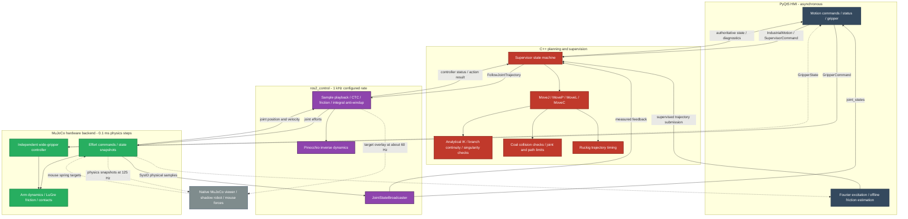
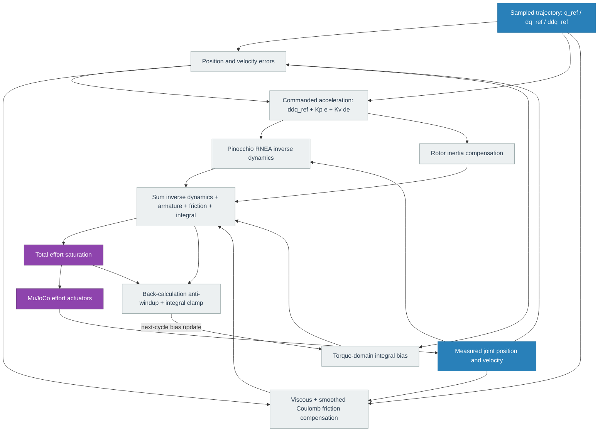
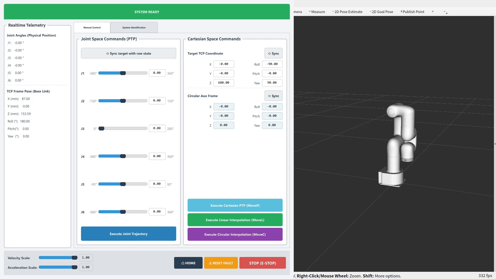
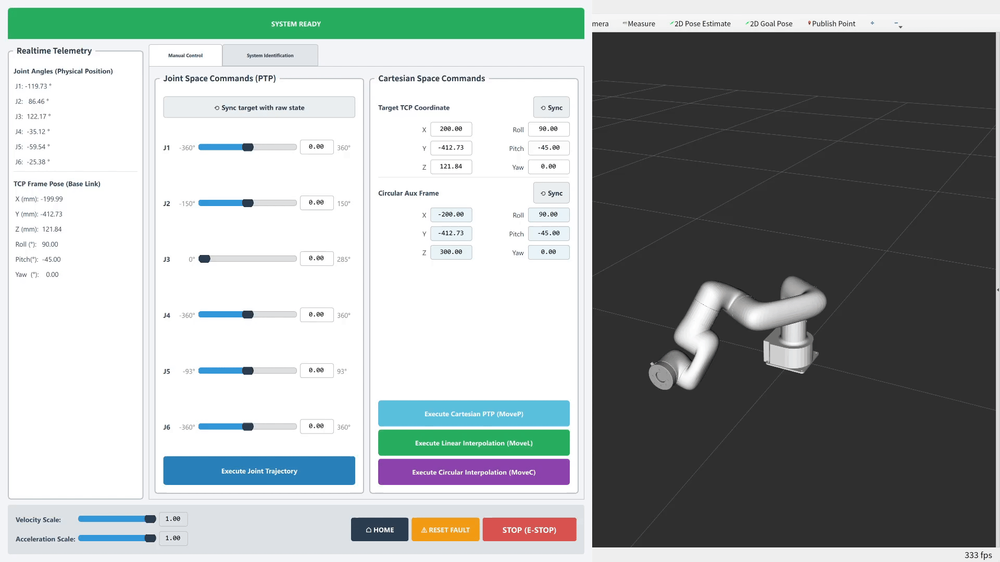
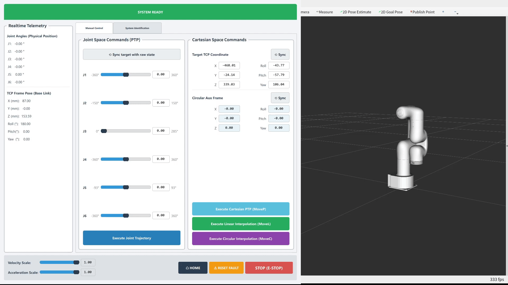

# Six-Axis Robot Simulation Framework

> **Education and research only.** This is a simulation project. The robot model originates from the publicly available [MuJoCo Menagerie](https://github.com/google-deepmind/mujoco_menagerie).
>
> Except for parameters supplied with that robot model in the official MuJoCo Menagerie repository, all parameters used in this project are the author's own reasonable assumptions for simulation and do not represent data from a real robot. This includes additional model settings, friction parameters, controller gains, planning limits, and supervisory thresholds.
>
> All planning and control algorithms are designed for research purposes; they do not represent the technology or algorithms used on a real robot.

### ROS 2 Motion Planning, Torque Control & MuJoCo Simulation


**Six-Axis Robot Simulation Framework** is an integrated **ROS 2 robot software architecture** for a six-axis robotic arm. It brings together **motion planning**, **computed torque control**, **robot dynamics**, **friction identification**, a **PyQt5 GUI**, **gripper control**, and **MuJoCo physics simulation** in one inspectable stack. The project uses a simulated six-axis arm to study how a complete robot control system connects user commands to motion execution and feedback.

A custom C++ planner implements **MoveJ, MoveP, MoveL and MoveC** with **analytical inverse kinematics**, **Coal / HPP-FCL collision detection**, singularity checks and **Ruckig jerk-limited trajectory generation**, without a MoveIt 2 dependency. An event-driven **Supervisor state machine** coordinates planning, execution, cancellation, software emergency stop, recovery and identification. A custom **ros2_control** controller runs **Computed Torque Control (CTC)** with **Pinocchio inverse dynamics**, rotor inertia compensation, **friction compensation**, and **integral control with anti-windup**.

The simulation uses effort actuators, **LuGre friction**, an independent fixed-step physics thread, and a native MuJoCo viewer with a target **shadow robot** and interactive force disturbances. The configured rates are **1 kHz control** and **10 kHz physics**, with asynchronous GUI, telemetry and rendering. Lock-free queues and snapshot buffers separate these workloads; achieved timing depends on the host and can be inspected through simulation diagnostics.

This repository is intended as a **robotics software architecture reference** for robot arm simulation, trajectory tracking, model-based control and manipulation research. It includes the control and supervision logic as well as the surrounding interfaces, configuration, diagnostics and operator workflow. The supplied hardware backend is MuJoCo simulation; deployment on a physical arm requires a suitable hardware interface and separate validation.

For implementation details and mathematical background, see the consolidated [technical report](docs/robot_simulation_technical_report.tex), covering planning, control, friction simulation and identification, and supervisory state transitions. Source code and configuration remain authoritative.

<p align="center">
  
</p>

## 📑 Table of Contents

1. [System Architecture](#-system-architecture)
2. [Core Features & Demonstrations](#-core-features--demonstrations)
3. [Quick Start & Reproduction Guide](#-quick-start--reproduction-guide)
4. [Suggested Demo Videos](#-suggested-demo-videos)
5. [Keywords & GitHub Topics](#-keywords--github-topics)
6. [Future Work](#-future-work)
7. [Acknowledgements](#-acknowledgements)
8. [Disclaimer](#-disclaimer)
9. [Contact](#-contact)

## 🧠 System Architecture

### From an operator command to physical execution

The GUI sends motion requests and supervised events. The **Supervisor owns the global operating state**; the GUI displays that state and does not independently authorize mode changes. Planning runs outside the control loop. Once validated, the complete sampled trajectory is sent to the CTC controller through `FollowJointTrajectory`.



### Component map and source entry points

The implementation is organized into seven ROS packages under `src/`. The entries below identify components by responsibility and list source basenames or model roles. Run `colcon list` from the repository root to inspect package names and locations.

| Component | Responsibility | Start reading here |
| --- | --- | --- |
| Bringup | Launch and process orchestration | `system_bringup.launch.py` |
| Planning and supervision | Kinematics, trajectory planning, collision validation and Supervisor | `motion_planner.cpp`, `kinematics_engine.cpp`, `supervisor.cpp`; `IndustrialPlannerNode` |
| Controllers | Effort controller and monitored trajectory execution | `ctc_controller.cpp`, `trajectory_execution.cpp` |
| Simulation backend | Physics thread, state exchange, gripper and native viewer | `simulation_exchange.hpp`, `gripper_control.cpp`, `mujoco_viewer.cpp`; MuJoCo hardware implementation |
| HMI | PyQt5 operator interface, ROS worker and SysID processing | `gui_main.py`, `supervisor_worker.py`, `sysid_engine.py` |
| Interfaces | Typed actions, services and status/telemetry messages | `IndustrialMotion.action`, `SupervisorState.msg` |
| Robot description | URDF, MuJoCo scene, meshes and model-generation tools | Full dynamics URDF, generated planning URDF, `scene.xml`, `generate_arm_model.py` |

### Control architecture

The controller directly reads measured joint position and velocity from the hardware state interfaces. It consumes the latest due position, velocity and acceleration sample without interpolating between trajectory points. **Trajectory completion requires measured endpoint settling**, in addition to reaching the final reference sample.



## 🎥 Core Features & Demonstrations

### 1. Four Motion Planning Modes

| Mode | Command | Path construction |
| --- | --- | --- |
| **MoveJ** | Six joint targets | Synchronized six-axis Ruckig point-to-point trajectory with joint velocity, acceleration and jerk limits. |
| **MoveP** | Cartesian target pose | Analytical IK candidates ranked against the starting configuration; candidate joint-space routes are validated before execution. The TCP path is not constrained to a straight line. |
| **MoveL** | Cartesian target pose | Straight TCP translation and axis-angle orientation interpolation along a continuous IK branch; joint spline with Ruckig path timing. |
| **MoveC** | Auxiliary pose and Cartesian target pose | Circular TCP arc through the start, auxiliary position and end position; start-to-end orientation interpolation, IK branch sampling and Ruckig path timing. |

The **analytical inverse kinematics** engine checks joint limits, singularities, branch continuity and collision validity. Cartesian paths use a natural cubic joint spline with refinement based on forward-kinematics position and orientation residuals. Conservative derivative bounds account for joint velocity, acceleration and jerk when choosing the scalar Ruckig time law. This is a bounded approximation to the requested Cartesian path, not a claim of globally time-optimal Cartesian motion.

**Collision detection** uses Coal (formerly HPP-FCL), URDF collision meshes, SRDF exclusions and a configured ground obstacle. The planner validates the starting configuration, trajectory samples and subdivisions between samples. It rejects invalid routes and reports diagnostics; it does not search arbitrary obstacle-avoiding detours. The planning model includes the gripper body and conservative finger envelopes covering the full jaw stroke. It does not automatically include arbitrary MuJoCo scene objects or carried objects. Scene extensions need corresponding planning-model work.

<p align="center">
  
</p>
<p align="center">
  
</p>
<p align="center">
  
</p>
<p align="center">
  
</p>

### 2. Computed Torque Control, Friction Compensation & Integral Action

The custom **ros2_control effort controller** uses Pinocchio's Recursive Newton–Euler Algorithm (**RNEA**) for model-based inverse dynamics. Position and velocity feedback shape the commanded acceleration; rigid-body dynamics, known rotor inertia, friction feedforward and a retained integral torque then determine the actuator command.

For each arm joint, the NORMAL-mode control law is:

```text
e       = q_ref - q_measured
de      = dq_ref - dq_measured
a_cmd   = ddq_ref + Kp*e + Kv*de
tau_ff  = RNEA(Q, V, [a_cmd, ddq_gripper])[:6] + armature*a_cmd
tau_f   = Fv*dq + Fc*tanh(tanh_slope*(dq_ref + friction_error_gain*e))
tau_raw = tau_ff + tau_f + tau_integral
tau_cmd = clamp(tau_raw, -max_effort, max_effort)

# Stored for the next control cycle:
tau_integral += dt*(Ki*e + antiwindup_gain*(tau_cmd - tau_raw))
tau_integral  = clamp(tau_integral, -integral_max_effort, integral_max_effort)
```

Here `Q` and `V` include the six arm joints and both gripper fingers; measured finger acceleration supplies `ddq_gripper`.

The **torque-domain integrator** corrects residual steady-state error, while **back-calculation anti-windup** responds to saturation of the total requested effort. NORMAL mode integrates position error without an error deadband. Software ESTOP retains the holding bias and allows anti-windup, but stops accumulating position error. SYS_ID clears the integral and disables friction compensation while retaining known rotor inertia compensation. Setting a joint's `ki` to zero disables its integral action.

MuJoCo simulates **LuGre dynamic friction**, including internal friction state, while the controller uses a simpler viscous/Coulomb compensation model. This creates a useful model-mismatch setting for trajectory tracking and disturbance-rejection experiments. Tracking accuracy should be reported with the trajectory, load, gains and measured errors; configured tolerances alone are not an accuracy benchmark.

### Encoder-Based Compliance and Drag Teaching

The **Compliance / Teaching** tab selects joint-space impedance, Cartesian-space impedance at `link_eef`, or drag teaching. Enter from stationary NORMAL mode. Entry captures the measured joint/TCP equilibrium; applying gains in the same mode preserves it unless **Capture current equilibrium** is selected. Joint gains use Nm/rad and Nm s/rad; Cartesian translation uses N/m and N s/m, and rotation uses Nm/rad and Nm s/rad. Cartesian axes are world-aligned.

These controllers use encoder position/velocity, model gravity, and (only for teaching) bounded nominal friction compensation. They do not consume effort feedback, contact forces, applied-force truth, or hidden LuGre state. They retain physical inertia rather than attempting arbitrary inertia shaping. NORMAL CTC and SYS_ID control laws and planner algorithms remain unchanged.

Teaching sensitivity ranges from 1 (firm) to 5 (light). Levels 1–3 retain the original damping and assistance mapping (joint damping 4 to 2.5 Nm s/rad, friction assistance 35% to 60%), while levels 4–5 use damping 2.25/2.0 Nm s/rad and assistance 62.5%/65%. Across all levels 1–5, the smooth friction transition width is 0.06 rad/s and Coulomb assistance is disabled below 0.06 rad/s and smoothly reaches full strength at 0.12 rad/s; viscous compensation remains active. This conservative near-rest gate suppresses self-excited jitter across all sensitivity levels while leaving static starting resistance intact. Gains change smoothly over a 0.15 s time constant. Teaching has zero position stiffness, so **Stop and return to NORMAL** brakes and holds the measured stopping pose. Mode switching requires stationary feedback, while same-mode gain updates are allowed during interaction. The shared **STOP (E-STOP)** button remains available in every mode; recovery uses the existing supervised recovery sequence.

In the MuJoCo viewer, select a link and use Ctrl + right drag for force or Ctrl + left drag for torque. **Capture point** stores measured joint angles. **Start recording** captures timestamped encoder positions at up to 100 Hz, capped at 60,000 samples. Leaving teaching, stale feedback, or a clock discontinuity stops recording. Exported JSON contains radians and timestamps, never measured force. Recordings require smoothing, retiming, and path validation before future playback; this tab does not add a playback planner.

The Supervisor excludes planning and identification while compliance is active and waits for controller acknowledgement on entry/exit. Compliance adds soft joint-limit walls, a 1.5 rad/s joint-speed stop, a 0.01 rad numerical allowance at hard limits, torque slew limiting, and persistent-saturation stopping; if any safety stop triggers during compliance, the HMI displays a detailed E-STOP popup identifying the violated limit, joint, and corrective action. Existing MuJoCo contacts remain physical constraints; no additional online geometric collision planner is introduced.

### 3. Supervisor, Execution Monitoring & Software E-Stop

An event-driven **finite-state machine** coordinates INITIALIZING, NORMAL, SYSID, ESTOP, RECOVERING and SOFT_FAULT modes, alongside separate motion phases. FAULT is a reserved interface value with no current entry transition. Session IDs and guarded events correlate identification and recovery operations. Controller acknowledgements and physical feedback govern transitions; accepting a service request does not mean the physical transition has completed.

* **Before execution:** Input validation, IK feasibility, collision checks, kinematic limits, mode authorization and fresh feedback are required.
* **During execution:** The CTC checks position/velocity path errors, persistent torque saturation, invalid numerical values and controller-mode changes.
* **At the endpoint:** The controller holds the final reference and requires continuous measured settling within the configured deadline. Defaults include 0.00015 rad position tolerance, 0.1 rad/s velocity tolerance, a 1 s settling interval and a 5 s endpoint allowance in NORMAL mode.
* **Software emergency stop:** The controller overrides the active reference with per-joint deceleration targets and retains closed-loop torque control. Braking uses configured decelerations and effort limits; the stopping path is not an obstacle-avoidance plan.
* **Recovery and identification transitions:** Reference synchronization, controller-mode acknowledgements and physical settling are coordinated by the Supervisor. Relevant transitions require all arm speeds to remain at or below 0.01 rad/s for 300 ms.

Heartbeat monitoring, bounded waits and diagnostic propagation prevent missing feedback or incomplete transitions from being treated as successful execution. Ordinary trajectory cancellation holds the measured position; emergency stopping has its own deceleration behavior. These are software mechanisms for the simulated arm, not a physical power-cut circuit.

<p align="center">
  
</p>

### 4. Automated Friction Identification

The **friction identification** workflow (internal protocol mode `SYSID`) generates bounded **Fourier excitation trajectories**, checks motion limits and collisions, records physical samples, and fits joint **viscous and Coulomb friction** using bounded least squares on generalized momentum integrals. Known rigid-body dynamics and rotor inertia are accounted for directly in the momentum balance; rotor inertia and LuGre dynamic parameters are not estimated by this workflow.

Preparation and message construction run in the background with GUI progress updates. The Supervisor handles alignment, controller-mode changes, planner validation, excitation and the guarded return to NORMAL. Excitation references use a 1 ms grid. Friction identification mode has separate endpoint tolerances because friction compensation and integral action are intentionally disabled.

The `/simulation/sysid_samples` stream records physical step numbers, simulation time, ROS-mapped timestamps, position, velocity, applied effort, control period, physics lag and command age. It is separate from `/joint_states` and published only while subscribed. Experiment windows align to the first CTC execution cycle using the excitation action UUID.

Repeated physical steps are removed before integration. Generalized momentum balance is integrated directly on exact non-uniform `simulation_time` intervals (using piecewise-constant ZOH actuator torque from `command_sequence` and `command_age`), avoiding numerical acceleration differentiation. The first and last second are excluded from fitting, and post-reversal settled sliding windows require `|velocity| >= 0.08 rad/s` and `>= 0.008 rad` of unidirectional travel past reversal to avoid LuGre bristle transients. Timing discontinuities, telemetry gaps and poor data quality are reported instead of silently producing parameters.

Raw experiments are saved as pickle-free `.npz` archives in a project-specific subdirectory of `ROS_HOME` (default `~/.ros`), together with a `.txt` result or failure report. The reported archive path identifies each recording. Output includes residuals, timing diagnostics and the YAML arrays `friction_v_nominal` (Nm·s/rad) and `friction_c_nominal` (Nm). Copy accepted results into the controller configuration and restart/reconfigure; estimation does not automatically retune the controller.

An estimation-quality failure follows a supervised return to NORMAL while retaining its diagnostic. Motion failures, missing feedback and transition timeouts follow the protective state-machine handling.

<p align="center">
  
</p>

### 5. PyQt5 GUI & Shadow Robot Visualization

The **PyQt5 human-machine interface (HMI)** exposes joint and Cartesian motion commands, feedback, operating state, identification progress and gripper controls. A ROS worker handles communication asynchronously; the displayed state follows the Supervisor. Duplicate SysID starts and local manual motions are blocked during identification preparation.

Press **S** in the native MuJoCo viewer to toggle the translucent cyan **shadow robot**. It displays the CTC's internal position reference, published at about 60 Hz from the 1 kHz control loop using `RealtimePublisher`. The physical robot shows the response to gravity, inertia, friction, contacts and applied disturbances. The overlay is a kinematic target visualization without physical collision response, rather than a second simulated controller.

Mouse spring forces and torques make disturbance rejection visible. The viewer runs in a separate process, so closing its window leaves physics and the HMI running.

<p align="center">
  
</p>

### 6. Independent Simulated Wide Gripper


The Gripper tab and `/gripper/command` provide `OPEN=1`, `CLOSE=2`, and `STOP=3`.
The gripper is independent of the arm Supervisor: normal arm motion, SysID and
the arm's **software** E-Stop do not cancel a gripper command or remove its
holding force. Commands require active gripper hardware and fresh physics
feedback. Hardware deactivation still makes the gripper unavailable.

`STOP` removes motor drive. Passive friction stops the jaws; there is no ideal
position brake and no promise of retaining an object after stopping. A held
`CLOSE` continues finite-force clamping during arm motion. These are simulated actuator behaviors based on the project's assumed drive model.

Calibration lives in `gripper.yaml` in the simulation backend package, loaded at hardware
initialization; restart after editing. The GUI cannot change these parameters.
The defaults limit each finger's reference to 0.05 m/s and 0.5 m/s², with a
10 N coupled motor force limit (approximately 5 N per jaw before losses).
A measured-speed torque envelope reduces motoring force to zero at the speed
limit and brakes overspeed with bounded force. Positions and velocities are
never overwritten to enforce limits; sufficiently large external forces can
still backdrive a physical force-limited actuator.

`GRASPED` is a **simulation estimate** derived from contact and motion feedback. It requires sustained inward normal force on both fingertips against
the same movable rigid object, stationary jaws, and a gap above the closed
endpoint. Robot self-contact, finger bases, fixed obstacles and single-sided
contact do not qualify. Contact loss is debounced and returns the state to
`CLOSING`; a continuing CLOSE may regrasp or reach `CLOSED`. An obstruction that
never establishes a grasp or endpoint times out with motor drive off. STOP
always clears grasp status and remains available even when the motion queue is full.

### 7. Real-Time Design & Simulation Diagnostics

The implementation separates control, physics and display work:

| Workload | Configured rate / behavior | Isolation mechanism |
| --- | --- | --- |
| CTC and joint feedback | 1000 Hz | `ros2_control` update loop; planning runs separately |
| MuJoCo physics | Fixed 0.1 ms steps, nominally 10 kHz | Dedicated thread paced by `steady_clock` |
| Effort command transfer | Timestamped command history | Bounded single-producer/single-consumer queue |
| Physics state transfer | Latest complete snapshot | Lock-free triple buffers with separate producer/consumer ownership |
| Viewer state transport | 125 Hz | Non-real-time publisher, queue depth one |
| Target overlay and rendering | About 60 Hz by default | `RealtimePublisher` for targets; separate GLFW/OpenGL process |
| SysID processing | On demand | Observational telemetry and background preparation/estimation |

The hardware requests `SCHED_FIFO` scheduling for its physics thread (default priority 60). If the operating system denies the request, it logs a warning and continues; monitor `/simulation/diagnostics` for lag, command age, snapshot age and faults. Command-history overflow and invalid numerical state are surfaced as faults. These design choices reduce interference and expose timing failures, but do not establish a hard real-time guarantee on every host.

The viewer never steps or edits the live physics model. Mouse targets cross a separate buffer; MuJoCo computes the spring force against the physical state on each step. Release events and a 200 ms steady-clock expiry clear stale perturbations. Viewer and hardware must run on the same host for this timestamp contract.

## 🚀 Quick Start & Reproduction Guide

### 📋 Native Environment

The intended environment is **Ubuntu 24.04**, **ROS 2 Jazzy**, **C++17**, **Python 3.12**, and the bundled **MuJoCo 3.9.0** distribution. Install ROS 2 Jazzy and the `colcon` / `rosdep` tools before the following steps. A graphical desktop with OpenGL support is needed for the native viewer and PyQt5 GUI.

```text
<repository-root>/
├── mujoco-3.9.0/           # MuJoCo headers and native libraries
├── src/                   # Seven ROS packages listed in the component map
├── docs/
│   └── robot_simulation_technical_report.tex
├── media/                 # Demonstrations
└── README.md
```

**1. Configure the environment:**

Open a terminal in the repository root before running these commands. Use the system Python environment associated with ROS 2 so that the GUI and robotics bindings resolve consistently.

```bash
source /opt/ros/jazzy/setup.bash
export MUJOCO_DIR="$PWD/mujoco-3.9.0"
export LD_LIBRARY_PATH="$MUJOCO_DIR/lib${LD_LIBRARY_PATH:+:$LD_LIBRARY_PATH}"
```

The hardware CMake configuration also defaults to the bundled `mujoco-3.9.0` directory when `MUJOCO_DIR` is unset. An explicit variable allows a different installation path; it must contain compatible headers and libraries.

**2. Install declared dependencies:**

```bash
# If rosdep has never been initialized on this machine, run once:
# sudo rosdep init
rosdep update
rosdep install --from-paths src --ignore-src -r -y
```

The package manifests declare dependencies including ros2_control, Pinocchio, Coal, Ruckig, GLFW, PyQt5, NumPy and SciPy. Resolve any errors reported by `rosdep` before building.

**3. Clean, compile and launch:**

Start from a fresh shell with the ROS environment configured above, without sourcing an old workspace overlay. Remove `build`, `install` and `log` **before every ROS 2 build**.

```bash
# Run only from this workspace root.
rm -rf build install log
colcon build --symlink-install
source install/setup.bash
ros2 launch "$PWD"/src/*_bringup/launch/system_bringup.launch.py
```

The launch command resolves the existing bringup file from the repository root. Bringup starts the controller manager, state publisher, controllers, native viewer, planner/Supervisor and HMI. Wait for fresh feedback and the ready state before sending motion. If a scheduling warning appears, inspect diagnostics and host permissions rather than assuming the nominal loop rates are being achieved.

### Configuration & ROS Interfaces

Configuration entries below use actual basenames where applicable; the robot XML and SRDF are identified by their roles in the description and planning packages.

| Configuration | Purpose |
| --- | --- |
| `ros2_controllers.yaml` | Control rate, PD/integral gains, friction/armature compensation, anti-windup, torque limits and execution tolerances |
| `kinematic_limits.yaml` | Joint position/velocity/acceleration/jerk and Cartesian motion limits |
| `ik_config.yaml` and planning SRDF | IK configuration, ground obstacle and collision-pair exclusions |
| `gripper.yaml` | Gripper motion, effort and grasp-detection parameters |
| `lugre_friction.hpp` | Simulated arm friction model and parameters |
| MuJoCo robot XML | MuJoCo timestep, actuators and simulated robot model |

| Interface | Role |
| --- | --- |
| `/industrial_motion` | `IndustrialMotion` action for MoveJ / MoveP / MoveL / MoveC |
| `/supervisor/command` | Guarded stop, recovery and SysID events |
| `/supervisor/state` | Authoritative mode, motion phase, freshness and diagnostics |
| `/supervisor/motion_rejections` | Reasons for rejected motion requests |
| `/supervisor/submit_sysid_trajectory` | Session-scoped SysID validation and submission |
| `/ctc_controller/follow_joint_trajectory` | Internal planner-to-controller sampled trajectory execution |
| `/ctc_controller/status` | Controller mode and execution timing/status |
| `/joint_states` | Measured joint feedback |
| `/simulation/diagnostics` | Physics timing and backend fault diagnostics |
| `/simulation/sysid_samples` | Physical telemetry for identification |
| `/shadow/joint_states` | Controller target positions for visualization |
| `/gripper/command`, `/gripper/state` | Independent gripper commands and feedback |

Application clients should use the supervised motion and command interfaces. Directly sending controller trajectories or mode commands bypasses parts of the orchestration contract.

### Native MuJoCo Viewer

The native MuJoCo/GLFW viewer uses MuJoCo's `mjv` / `mjr` renderer and perturbation APIs. The scene places the robot on a 2.4 × 1.5 m workbench, with the tabletop at `z=0` and floor 0.8 m below it. Tabletop and floor have physics collision geometry; decorative geometry is not automatically a planner obstacle. The HMI remains responsible for robot commands.

| Input | Action |
| --- | --- |
| Left drag / right drag / wheel | Orbit / pan / zoom |
| Double-click a robot link | Select the link |
| Ctrl + right drag | Apply a spring force to the selected link |
| Ctrl + left drag | Apply a spring torque |
| Shift while dragging | Use the horizontal movement/rotation plane |
| Home / S / H | Restore camera / toggle cyan target robot / toggle help |
| Esc | Close the viewer; physics and HMI continue running |

```bash
# Run from the repository root with the workspace environment sourced.
# Start with the target overlay visible.
ros2 launch "$PWD"/src/*_bringup/launch/system_bringup.launch.py viewer_shadow:=true
# Optional cast shadows.
ros2 launch "$PWD"/src/*_bringup/launch/system_bringup.launch.py viewer_shadows:=true
# Disable the 3D viewer; the PyQt5 HMI still launches.
ros2 launch "$PWD"/src/*_bringup/launch/system_bringup.launch.py viewer:=false
# Reopen only the display while the system is running.
viewer_package=$(ros2 pkg executables | awk '$2 == "mujoco_viewer" {print $1; exit}')
ros2 run "$viewer_package" mujoco_viewer
```

`viewer_fps` accepts 15–240 (default 60). The initial window is 1920 × 1080, clamped to the desktop work area. Achieved FPS depends on the GPU and system load. Cast shadows are disabled by default; 8× MSAA is requested subject to GPU support. Visual OBJ meshes preserve the original STL triangles and face normals. After changing source visual meshes, regenerate them with `python3 src/*_description/tools/generate_visual_meshes.py`. Collision meshes remain separate and hidden.

Stale feedback is labelled CONNECTING and disables dragging; the shadow overlay expires when its data becomes stale. Mouse interaction applies forces and torques without teleporting joints or pausing physics.

## 🎬 Suggested Demo Videos

The GIFs above are existing demonstrations. For the release, record fresh footage of the current GUI, viewer and behavior. Prioritize an overview, the four motion modes, and supervised stopping/recovery; then add focused clips for the remaining subsystems.

| Video | Suggested length | What to show |
| --- | --- | --- |
| **Full system overview** | 60–90 s | Start in the ready state, show the GUI and viewer together, execute a motion, enable the shadow robot, operate the gripper, stop and recover. Use as the first README video. |
| **MoveJ / MoveP / MoveL / MoveC** | 2–3 min | Label each command and target. Contrast joint-space PTP with straight and circular TCP paths; show speed/acceleration scaling and action completion. |
| **CTC tracking and disturbance rejection** | 1–2 min | Show the target overlay, apply a mouse spring disturbance, release it and show settling. Include measured joint errors and torque plots from the same run. |
| **Collision and execution protection** | 1–2 min | Show a rejected colliding target/path, an unreachable or singular target, and the actual diagnostics. Demonstrate software E-Stop during motion and the guarded recovery sequence. |
| **Friction identification and compensation** | 2–3 min | Show preparation, alignment, Fourier excitation, fitting, residuals and saved results. If comparing compensation settings, use the same trajectory and label each configuration. |
| **Wide gripper behavior** | 1–2 min | Demonstrate OPEN/CLOSE/STOP. With a prepared movable-object scene, show finite-force holding, the simulated GRASPED state and contact loss; explain that arm E-Stop does not cancel gripper holding. |
| **Timing and process isolation** | 1–2 min | Show physics lag and command-age diagnostics while moving/resizing/closing/reopening the viewer. State CPU, OS, scheduling permissions and observed timing. |

Use readable 1080p footage and short captions. Keep one compact preview near the top of this README and link longer recordings from the relevant feature sections. Publish measured values with their conditions; visual overlap alone does not establish tracking accuracy or real-time performance.

## 🔎 Keywords & GitHub Topics

**Suggested repository name:** `six-axis-robot-simulation`

**Suggested GitHub description:**

> ROS 2 robot arm framework with analytical IK, Ruckig motion planning, computed torque control, friction identification, supervised execution, gripper control and MuJoCo simulation.

**Suggested GitHub topics** (copy as individual topics):

```text
robotics ros2 ros2-control robot-arm mujoco motion-planning
trajectory-generation ruckig inverse-kinematics collision-detection
pinocchio computed-torque-control friction-compensation system-identification
robot-simulation gripper pyqt5 real-time-control robotics-software
```

**Technical keywords:** ROS 2 Jazzy; six-axis robotic manipulator; robot software architecture; model-based control; inverse dynamics; analytical inverse kinematics; joint-space planning; Cartesian path planning; MoveJ; MoveP; MoveL; MoveC; jerk-limited trajectory generation; Coal / HPP-FCL; singularity detection; trajectory tracking; torque control; integral control; anti-windup; LuGre friction; Fourier excitation; least-squares parameter estimation; finite-state machine; software emergency stop; recovery; human-machine interface; lock-free state exchange; simulation diagnostics.

## 🔮 Future Work

Potential extensions to the current architecture include:

* **Manipulation workflows:** Reproducible object scenes and pick-and-place sequences using the existing wide gripper.
* **Planning-scene coverage:** Carried-object and scene-obstacle geometry synchronized with the planner, extending the existing gripper envelopes.
* **Advanced control:** Impedance and admittance control, with comparisons against the CTC baseline.
* **Identification and evaluation:** Richer friction parameter estimation and reproducible tracking/timing benchmarks.
* **Physical hardware integration:** A real-arm backend with hardware-specific limits, feedback and validation.

## 🙏 Acknowledgements

I would like to sincerely thank the creators and maintainers of the following open-source projects and organizations:

*   **[MuJoCo](https://mujoco.org/)**
*   **[MuJoCo Menagerie](https://github.com/google-deepmind/mujoco_menagerie)**
*   **[ros2_control](https://control.ros.org/)**
*   **[Pinocchio](https://stack-of-tasks.github.io/pinocchio/)**
*   **[Coal / HPP-FCL](https://github.com/coal-library/coal)**
*   **[Ruckig](https://ruckig.com/)**

## 📌 Disclaimer

This is a personal, open-source project. I am not affiliated with, sponsored by, or endorsed by any commercial entities mentioned in this repository. All trademarks and registered trademarks are the property of their respective owners. The software is provided "as is", without warranty of any kind.

## 📬 Contact

If you have any questions about this repository, you can raise an issue or contact [](mailto:wtianyi947@gmail.com) directly.
